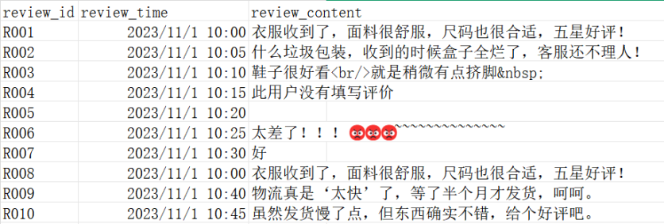
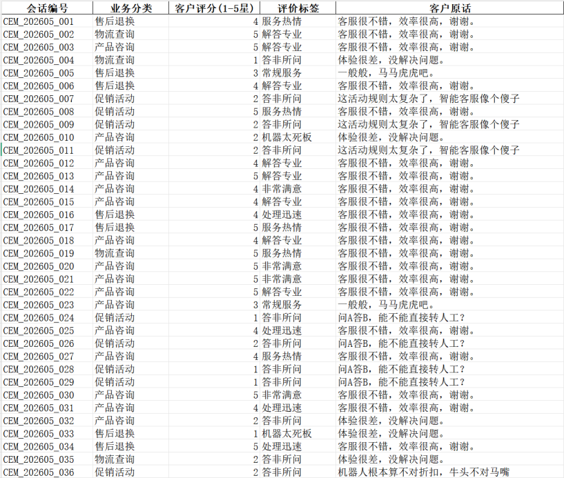
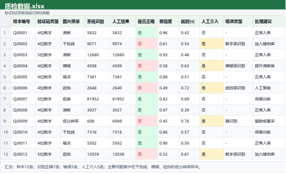
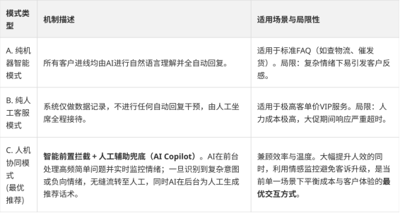
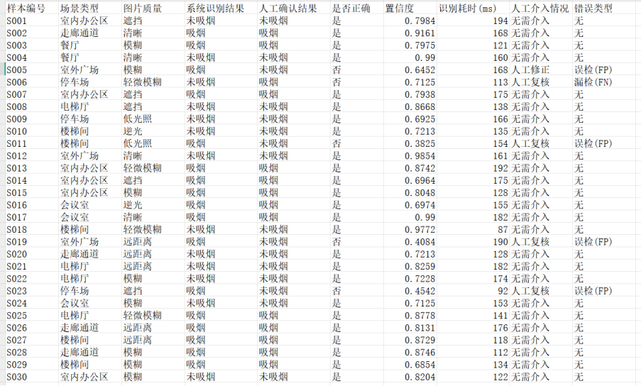

# 人工智能训练师（三级／高级）模拟试题

人工智能训练师（三级／高级）参考试卷如下
各位同学好，为确保大家顺利通过考核，请留意以下学习规范：
1. 严守考纪：监考系统严密，请大家务必诚信应考，独立完成练习，切勿尝试违规操作。
1. 拒绝搬运：学习重在理解，请独立消化知识点，避免直接照搬标准答案，真正将技能转化为自己的能力。
1. 答疑机制：遇疑难问题可随时私信客服提问，但请务必严禁私下传播试题，共同维护公平环境。
1. 心态策略：放平心态，抓大放小。及格即可，遇到偏题难题果断跳过，不必死磕。
1. 善用资料：资料中标红内容为辅助提示，请结合解析查漏补缺，切勿直接按照原文作答。

---

# 理论知识考核试题 01&07

001        "职业道德是一定职业领域中的人们应该坚持的一种行为准则，这种准则通常基于( )。
A、高尚情操 B、社会舆论 C、传统习惯 D、内心信念
【答案】D
【解析】职业道德是一种内在的约束机制，它主要通过从业者的内心信念来维持和发挥作用，虽然社会舆论和传统习惯也有影响，但内心信念是其最根本的基础。"
002        "随着时间的推移和不同社会阶层的存在，职业道德标准呈现出明显的 () 色彩。
A. 相同性 B. 人文性 C. 阶级性 D. 集体性
【答案】C
【解析】职业道德会依附于不同社会阶层、社会地位产生差异，不同阶级对应的职业行为规范、道德要求各不相同，因此职业道德具备鲜明的阶级性特征。相同性、人文性、集体性均不是该场景下的核心特征。"
003        "职业道德的特征主要表现为：一定的强制性、利益的相关性、( )。
A、鲜明的行业性 B、范围的有限性 C、相对的稳定性 D、形式的多样性
【答案】A
【解析】职业道德具有鲜明的行业性，不同职业的道德要求和规范各不相同，此外还包括一定的强制性和利益相关性等特征。"
004        "社会主义职业道德的准则和规范源于（）的道德准则和规范。
A. 无产阶级 B. 资产阶级 C. 中产阶级 D. 农民阶级
【答案】A
【解析】社会主义制度以无产阶级为领导核心，对应的职业道德体系、行为准则均建立在无产阶级道德规范基础之上，资产阶级、中产阶级、农民阶级的道德体系均不是其源头。"
005        "社会主义职业道德的准则和规范源于( )的道德准则和规范。
A、无产阶级 B、资产阶级 C、中产阶级 D、农民阶级
【答案】A
【解析】社会主义职业道德是在社会主义制度下形成的，其本质上源于无产阶级的道德准则和规范，体现了集体主义和为人民服务的精神。"
006        "人工智能职业道德的核心内涵是？
A. 仅追求技术突破，无需考虑社会影响
B. 将伦理道德融入 AI 全生命周期，关注技术的社会价值
C. 优先保障企业商业利益
D. 完全依赖技术人员的个人道德自觉
【答案】B
【解析】人工智能技术影响力大、覆盖面广，其职业道德要求伦理先行，把道德规范贯穿于研发、训练、落地、运维等全流程，兼顾技术创新与社会公共价值。A片面追求技术、C优先商业利益、D单纯依靠个人自觉，均违背AI职业道德要求。"
007        "人工智能行业的数据特点包括？( )
A、数据量小，质量要求低 B、数据量大，对数据质量要求高 C、不需要大量数据支持 D、数据来源单一即可
【答案】B
【解析】人工智能模型的训练高度依赖数据，通常需要海量的数据进行驱动，同时对数据的质量（如准确性、一致性等）有很高的要求，否则会导致模型效果不佳。"
008        "以下哪项是人工智能职业道德的基本原则？
A. 数据垄断以提升技术优势
B. 允许算法偏见以提高效率
C. 确保人类对 AI 的最终控制权
D. 优先使用未授权用户数据
【答案】C
【解析】人机协同的核心原则为人类主导、人类掌控，必须保证人类对人工智能拥有最终控制权。A数据垄断、B算法偏见、D滥用未授权数据，均属于违规、违背职业操守的行为。"
009        "( )首先提出了计算机的基础结构，即将程序和数据一起存储的设计方案。
A、冯・诺依曼 B、爱因斯坦 C、牛顿 D、爱迪生
【答案】A
【解析】冯·诺依曼提出了“冯·诺依曼体系结构”，其核心思想是存储程序和程序控制，即将程序和数据一起存储在计算机的存储器中。"
010        "人工智能行业区别于传统行业的核心特点是？
A. 劳动密集型生产 B. 数据驱动与跨界融合
C. 单一学科技术主导 D. 完全依赖硬件设备
【答案】B
【解析】人工智能以海量数据为核心生产资料，同时融合计算机、数学、语言学、行业业务等多门学科，具备数据驱动、跨界融合两大核心特征。传统行业多为劳动密集型，AI并非单一学科、也不单纯依赖硬件。"
011        "关于 ETL 数据集成的主要目的是 ( )
A. 将数据存储在一个 PPT 文件中 B. 通过采用规模化表格，集成多个数据源 C. 降低数据安全性 D. 降低数据性能
【答案】B
【解析】ETL（Extract-Transform-Load，抽取-转换-加载）的主要目的是将分散的、异构的多个数据源整合到一起，为上层分析和应用提供统一的数据支持。"
012        "世界上第一台电子计算机 ENIAC 使用的主要逻辑元件是？
A. 继电器 B. 晶体管 C. 电子管 D. 集成电路
【答案】C
【解析】计算机发展四代硬件划分：第一代（ENIAC）使用电子管；第二代使用晶体管；第三代使用中小规模集成电路；第四代使用大规模、超大规模集成电路。"
013        "以下哪一个选项不包括在计算机网络按地理覆盖范围分类中? ()
A.局域网 B.广域网 C.城域网 D.无线网
【答案】D
【解析】计算机网络按地理覆盖范围可分为局域网（LAN）、城域网（MAN）和广域网（WAN）。无线网是按传输介质分类的，不是按覆盖范围分类。"
014        "计算机软件系统的核心是？
A. 硬件驱动程序 B. 操作系统 C. 办公软件 D. 游戏程序
【答案】B
【解析】操作系统（OS）负责统一管理计算机硬件资源、软件资源，为各类应用程序提供运行环境，是整个计算机软件系统的核心。驱动、办公软件、游戏都属于上层应用/辅助程序。"
015        "计算机安全领域中，( )通常指保护计算机系统中的物理设备，包括网络、存储设备计算机硬件免受未经授权的访问和破坏。
A.硬件安全 B.软件安全 C.数据安全 D.管理人员
【答案】A
【解析】保护计算机物理设备（如网络、存储、硬件等）免受破坏和未授权访问，属于硬件安全的范畴。"
016        "计算机网络按地理覆盖范围分类不包括？
A. 局域网 B. 广域网 C. 城域网 D. 无线网
【答案】D
【解析】按地理覆盖范围划分，计算机网络分为局域网（LAN）、城域网（MAN）、广域网（WAN）；无线网是按照传输介质划分的网络类型，不属于按覆盖范围的分类。"
017        "( )是计算机网络必备的硬件设备，它连接计算机和传输介质，是计算机能够联网的关键组件。
A.路由器 B.集线器 C.中继器 D.网卡
【答案】D
【解析】网卡（网络适配器）是计算机与网络传输介质连接的必备硬件，负责将计算机数据转换为能在传输介质上传输的信号。"
018        "数据保护的核心原则不包括？
A. 数据最小化 B. 数据加密 C. 随意存储 D. 访问控制
【答案】C
【解析】数据保护要求遵循数据最小化、数据加密、权限访问控制等原则，严禁随意存放、泄露、滥用数据，随意存储严重违反数据安全规范。"
019        "在 RGB 颜色模式中，RGB 值为 (255.0.0) 所代表的颜色是 ( ).
A. 红 B. 绿 C. 蓝 D. 黑
【答案】A
【解析】RGB分别代表红、绿、蓝三个颜色通道。当R为255，G和B为0时，表示只有红色通道达到最大亮度，因此显示为纯红色。"
020        "WPS AI 在 WPS 演示中的典型功能是？
A. 自动生成 PPT 大纲和内容 B. 仅支持文字校对
C. 强制添加广告 D. 无法关联云文档
【答案】A
【解析】WPS AI 深度适配办公组件，在PPT模块中可智能生成演示文稿大纲、正文内容、版式等，大幅提升制作效率。B功能描述片面，C、D均不符合软件实际功能。"
021        "以下属于计算机安全的是( ).
A.硬件安全 B.软件安全 C.数据安全 D.以上皆是
【答案】D
【解析】计算机安全是一个综合性概念，涵盖了硬件安全、软件安全和数据安全等各个方面。"
022        "WPS 文字提供了 () 的显示方式，更改格式后即可查看效果。
A. 页面 B. 所见即所得 C. 大纲 D. 阅读
【答案】B
【解析】“所见即所得”是主流办公软件的核心特性，用户在界面中修改字体、段落、版式等格式，页面会实时展示最终打印/输出效果，页面、大纲、阅读仅为不同视图模式。"
023        "测试人工智能模型核心环节需要考虑 ( ).
A. 测试用例 B. 测试方法 C. 测试计划 D. 测试报告
【答案】A
【解析】测试用例是测试执行的核心依据，无论是何种测试，设计覆盖全面且具有代表性的测试用例都是核心环节。"
024        "根据《劳动法》，下列哪类人员适用本法？
A. 现役军人 B. 与企业签订劳动合同的劳动者
C. 家庭保姆 D. 公务员
【答案】B
【解析】《中华人民共和国劳动法》适用于与用人单位建立劳动关系、签订劳动合同的劳动者。现役军人、公务员受对应专项法规管理，家庭保姆属于私人雇佣关系，均不适用《劳动法》。"
025        "scikit-learn (sklearn) 是一个用于机器学习的开源库，它基于以下哪个编程语言开发？
A. Python B. Java C. C++ D. R
【答案】A
【解析】scikit-learn 是基于 Python 语言开发的知名机器学习库，建立在 NumPy、SciPy 和 matplotlib 之上。"
026        "劳动合同订立的核心原则是？
A. 企业单方决定 B. 行政强制 C. 平等自愿、协商一致 D. 口头约定优先
【答案】C
【解析】劳动合同签订的法定核心原则为平等自愿、协商一致，用人单位与劳动者地位平等。企业单方决定、行政强制属于违规行为，劳动关系必须以书面劳动合同为准，口头约定不具备合法效力。"
027        "常见的图像处理软件是( )
A.Foxpro B.Oracle C.Photoshop D.WPS2000
【答案】C
【解析】Photoshop（PS）是 Adobe 公司开发的著名图像处理软件；Foxpro和Oracle是数据库相关软件；WPS是办公软件。"
028        "网络运营者需保障数据的 “完整性、保密性、可用性”，这属于哪项原则？
A. 数据最小化 B. 安全保障义务 C. 随意存储 D. 利益优先
【答案】B
【解析】保障数据完整（不丢失、不篡改）、保密（不泄露）、可用（正常访问使用），是国家法律法规规定的网络运营者数据安全保障义务。其余选项均不符合题意。"
029        "在 EasyDL 中，用户通常只需标注数据集的比例达到多少即可开始训练模型？
A. 0.2 B. 0.3 C. 0.4 D. 0.5
【答案】A
【解析】在百度的EasyDL平台中，利用主动学习等技术，通常只需标注20%（0.2）左右的数据即可启动首轮模型训练，后续可通过难例挖掘补充标注。"
030        "假冒注册商标罪的入罪标准不包括？
A. 违法所得 3 万元以上 B. 两年内二次侵权
C. 非法经营额 5 万元以上 D. 仅销售未生产
【答案】D
【解析】根据相关司法解释，违法所得3万元以上、非法经营额5万元以上、两年内两次以上商标侵权，均构成假冒注册商标罪入罪条件；仅参与销售、未实施生产行为，不满足该罪名认定标准。"
031        "主成分分析（PCA）的主要目的是
A. 特征选择 B. 数据可视化 C. 数据降维 D. 数据预处理
【答案】C
【解析】主成分分析（PCA）是一种常用的无监督学习方法，其主要目的是通过线性变换将高维数据映射到低维空间，实现数据降维。"
032        "以下哪项说法不属于大数据的特点？( )
A. 数据量大 B. 数据种类和来源多样化
C. 数据价值密度相对较高 D. 数据处理速度快
【答案】C
【解析】大数据四大经典特征（4V）：Volume（海量）、Variety（多样）、Velocity（高速）、Veracity/Value（价值密度低）。海量数据中有效信息占比少，因此价值密度低，C选项表述错误。"
033        " 数据处理规范主要是指什么？
A. 数据采集过程中的规范 B. 数据存储过程中的规范 C. 数据清洗和数据标注过程中的规范 D. 数据分析过程中的规范
【答案】C
【解析】在人工智能训练师的语境下，数据处理规范主要针对的是数据清洗和标注环节的操作标准与质量规范，以保证输入模型的数据质量。"
034        "在大数据采集阶段，我们的态度应该是 “全而细”，“全 "" 指的是 ( ).
A. 在采集阶段要尽可能的采集到的每个数据 B. 各类数据都要采集到
C. 对于结构化的海量数据需要全面清洗 D. 网络信息采集模块需要全周期管理
【答案】B
【解析】大数据采集“全而细”中，“全”指数据类型、数据维度全面，覆盖业务相关的各类数据；“细”指数据粒度精细。A表述绝对，C属于数据清洗工作，D属于运维管理，均不符合“全”的定义。"
035        "在点云数据分割中，下列哪种方法常用于基于几何特征的分割任务？
A. 基于颜色聚类算法 B. 高斯混合模型 C. 法线估计 D.RANSAC算法
【答案】D
【解析】RANSAC（随机抽样一致）算法常用于从包含大量噪声的点云数据中拟合出几何特征（如平面、圆柱等），是基于几何特征分割的常用方法。"
036        "网络数据采集能够获取哪些种类的信息？
A. 网页数据 B. 图像数据 C. 音视频数据 D. 以上都是
【答案】D
【解析】网络数据源形式丰富，网络采集工具可抓取网页文本、图片、音频、视频等多种格式的数据，因此ABC三项均正确。"
037        "语音内容转写完成、进入文本格式化校验环节时，最基础且必须统一处理的是哪一项？
A. 噪音 B. 感叹词 C. 数字 D. 标点符号
【答案】D
【解析】语音转写为文本后，最基础的格式化就是添加和校验标点符号，以确保句子语义的断句准确。"
038        "( ) 的目标是在保留尽可能多的数据原貌的同时，减少数据量，从而使得数据仍然保持其原先的表现形式。
A. 数据转换 B. 数据清洗 C. 数据规约 D. 数据集成
【答案】C
【解析】数据规约是数据预处理技术之一，核心作用是在不改变数据原有形态、保留核心信息的前提下精简数据体量，降低后续计算压力。数据转换侧重格式修改，清洗侧重剔除脏数据，集成侧重多表合并。"
039        "以下选项中，机器学习算法真正用来 "" 学习” 的数据是 ( )。
A. 验证数据集 B. 训练数据集 C. 测试数据集 D. 超参数集
【答案】B
【解析】训练数据集是用来输入给机器学习算法进行参数学习和模型拟合的数据；验证集用于调参，测试集用于评估。"
040        "( ) 是一种数据预处理技术，它可以将原始数据转换为所需的格式，以便于进一步的数据分析和挖掘。
A. 数据清洗 B. 数据集成 C. 数据规约 D. 数据变换
【答案】D
【解析】数据变换专门负责对原始数据进行格式转换、标准化、归一化等操作，统一数据形态，适配数据分析、机器学习建模要求。"
041        "任何单位和个人不得违法干预当事人自愿订立合同的 ( )，如有违反将受到《合同法》的制裁。
A. 利益 B. 责任 C. 权利 D. 义务
【答案】C
【解析】合同法保护当事人自愿订立合同的权利，违法干预他人合同权利的行为将受法律制裁。"
042        "对于数据 ( ) 评估，记录的数量和唯一值的数量可以用来作出评估。
A. 完整性 B. 强制性 C. 常见性 D. 及时性
【答案】A
【解析】评估数据完整性时，可通过统计数据总条数、字段唯一值数量、缺失值占比等指标，判断数据是否存在缺失、断档等问题。强制性、常见性、及时性均不使用该评估方式。"
043        "在模式识别中，特征选择的目标是：
A. 降低维度 B. 增加噪声 C. 增强数据 D. 数据预处理
【答案】A
【解析】特征选择是从原始特征中挑选出最有效的特征子集，其主要目标之一就是降低数据维度，消除冗余特征，提升模型效率。"
044        "探索性数据分析（EDA）的核心目标是？
A. 直接构建机器学习模型
B. 通过可视化和统计方法发现数据模式与异常
C. 仅清洗数据缺失值
D. 依赖先验假设验证模型
【答案】B
【解析】探索性数据分析（EDA）是数据分析前期核心工作，依靠统计计算、图表可视化等方式，挖掘数据内在规律、识别异常值、分布特征。EDA不直接建模，也不单纯做数据清洗。"
045        "常用的文件扩展名，用于存储图像数据的标注结果，其中包括 ( ).
A.TXT B.JSON C.EXE D.YML
【答案】B
【解析】JSON格式由于其良好的层级结构，常被用于存储图像标注中的边界框、多边形等结构化坐标信息。"
046        "探索性数据分析（EDA）的主要作用不包括？
A. 识别数据异常值 B. 提出分析假设 C. 直接生成最终报告 D. 为建模清洗数据
【答案】C
【解析】EDA可以识别异常、推导分析思路、辅助数据预处理，但它属于前期探查工作，无法直接生成正式的最终分析报告。"
047        " 语音识别技术的研究涉及多个基础学科，其中属于人体生命科学范畴的是（）。
A. 生理学 B. 物理学 C. 人的体态语言 (说话时的行为动作) D. 量子力学
【答案】A
【解析】语音识别涉及发音器官和听觉器官的机制，这属于生理学的研究范畴，生理学是人体生命科学的重要组成部分。"
048        "在 Python 中，绘制 KDE 分布图常用的库是？
A. Matplotlib B. Seaborn C. Pandas D. NumPy
【答案】B
【解析】NumPy用于数值计算，Pandas用于数据表格处理，Matplotlib是基础绘图库；Seaborn基于Matplotlib二次封装，针对统计图形做了优化，是绘制核密度分布图（KDE）的主流工具。"
049        "()操作系统允许在一台计算机上同时连接多个用户终端，把处理机的运行时间分成很短的时间片，并按时间片轮流方式把处理机分配给各联机作业使用。
A.分时操作系统 B.实时操作系统 C.单用户操作系统 D.多用户操作系统
【答案】A
【解析】时间片轮转调度是分时操作系统的典型特征，它使得多个用户可以同时使用一台计算机并感觉独占资源。"
050        "双变量分析的核心是？
A. 单独分析每个变量的分布 B. 研究两个变量之间的关系
C. 仅处理分类变量 D. 忽略数据异常值
【答案】B
【解析】单变量分析侧重单个数据指标的分布特征；双变量分析专门研究两个变量之间的相关性、影响关系，可同时处理连续变量与分类变量，分析过程不能忽略异常值。"
051        "企业正在努力寻求变革与创新，目前更多地关注于 ( ).
A. 业务流程重组 B. 业务流程优化 C. 重新设立企业架构 D. 重构企业文化
【答案】B
【解析】相比于彻底的业务流程重组（BPR），现代企业在变革中更多采取循序渐进的业务流程优化（BPI），以更低的风险实现持续改进。"
052        "分析 “乘客年龄与票价” 的关系时，最适合的双变量图表是？
A. 直方图 B. 散点图 C. 条形图 D. 箱线图
【答案】B
【解析】年龄、票价均为连续数值型变量，散点图是展示两个连续变量关联趋势的最优图表。直方图展示单变量分布，条形图对比分类数据，箱线图展示数据四分位数与异常。"
053        "将缺失属性值的对象 (元组、记录) 直接删除，从而得到一个完整信息表的数据清理方法为 ( )。
A. 忽略元组 B. 使用属性的平均值填充空缺值 C. 使用与给定元组属同一类的所有样本的平均值 D. 使用最可能的值填充空缺值
【答案】A
【解析】直接删除含有缺失值的记录/元组，在数据清洗中称为“忽略元组”或“删除法”。"
054        "初级数据标注员质量提升计划的周期通常为？
A. 1 天 B. 1 周 C. 1 个月 D. 半年
【答案】C
【解析】零基础初级标注员需要完成理论学习、实操练习、质检复盘全流程，结合行业通用培训标准，质量提升专项计划常规周期为1个月。"
055        "( ) 的主要目的是从输入图像中检测出特定的对象，并为每个像素分配相应的类别标签。
A. 语义分割 B. 实例分割 C. 图像分类 / 判断 D. 图像检测
【答案】A
【解析】语义分割的任务是像素级别的分类，即为图像中的每一个像素分配一个类别标签，而不区分同类的不同个体。"
056        "需求优先原则的核心价值是？
A. 随意分配资源，满足所有需求 B. 聚焦高价值任务，优化资源利用
C. 仅关注技术实现难度 D. 避免与团队沟通优先级
【答案】B
【解析】工作中需求数量多、资源有限，需求优先原则就是对任务排序，优先处理高价值、高紧急度工作，合理调配人力、算力等资源，提升整体工作效率。"
057        " ( ) 不属于视频标注的分类。
A. 视频追踪 B. 视频剪辑 C. 视频分类 D. 视频打点
【答案】B
【解析】视频剪辑是对视频素材的加工编辑，而非针对AI模型训练的数据标注任务。视频标注包括分类、追踪、打点（时间戳标注）等。"
058        "数据标注质量检验的核心目的是？
A. 增加标注员工作量 B. 避免错误标注误导模型训练
C. 仅为完成项目流程 D. 减少标注工具使用
【答案】B
【解析】标注数据是人工智能模型的训练基础，错误标注、劣质数据会严重干扰模型学习，导致模型精度下降。质检的核心就是把控标注质量，规避该问题。"
059        "需求方应该明确表达他们想要的所需模型效果，并与 ( ) 合作制定标注规则，以满足需求。
A. 物业经理 B. 模型师 C. 财务经理 D. 人事经理
【答案】B
【解析】模型师/算法工程师了解模型对数据格式和质量的要求，因此需求方需与模型师合作，共同制定出能训练出合格模型的标注规则。"
060        "数据标注中，若全样检验发现数据质量不合格（常见问题），对应的解决方法是？
A、将不合格数据直接交付 B、放到合格数据集中
C、放到未合格数据集中待修正 D、忽略不合格数据
【答案】C
【解析】标注项目验收要求数据100%合格，不合格数据严禁混入合格数据集、禁止直接交付或忽略，必须单独归档，安排标注人员返工修正。"
061        "根据《合同法》，仅以声音为传播载体、不包含任何视觉元素的广告指在报纸、( ) 等媒介上发布的，目的在于推销和宣传商品或服务的一种行为。
A. 杂志 B. 广播 C. 电视 D. 互联网
【答案】B
【解析】报纸和杂志是视觉载体，电视和互联网通常包含视听元素，只有广播是仅以声音为传播载体的媒介。"
062        "开源图像标注工具中，支持多边形、矩形、关键点标注的是？
A. LabelMe B. Scale AI C. Hive Data D. DataLoop
【答案】A
【解析】LabelMe是业内主流开源图像标注工具，全面支持矩形框、多边形、关键点、语义分割等多种标注类型；其余三款多为商业标注平台，并非开源工具。"
063        "目前解决数据集成主要难点不是因为数据之间的 ( ).
A. 异构性 B. 分布性 C. 同构性 D. 自治性
【答案】C
【解析】数据集成的难点在于各数据源的异构性（结构、格式不同）、分布性和自治性（各自独立管理）。同构性意味着结构一致，反而容易集成，不是造成难点的原因。"
064        "支持视频跨帧追踪的国产标注工具是？
A. 数加加 B. VoTT C. Supervise.ly D. ImgLab
【答案】A
【解析】数加加是国产专业数据标注平台，具备视频目标跨帧自动追踪功能，大幅提升视频标注效率；VoTT、Supervise.ly、ImgLab均为海外开源/商业工具。"
065        "业务流程优化中的流程分析包括：
A. 理解步骤、活动和决策点之间的关系 B. 降低成本 C. 提高效率 D. 技术支持和自动化
【答案】A
【解析】流程分析的核心是梳理和厘清现有流程的逻辑，即理解各个步骤、活动和决策点之间的相互关系；而降低成本、提高效率是优化的目的，技术支持是实现手段。"
066        "如果你需要训练一组图片数据，建议使用 ( ) 来作为训练模型。
A. 逻辑回归 B. 随机森林 C. 支持向量机 D. 神经网络
【答案】D
【解析】图像数据特征维度高、语义复杂，深度神经网络是计算机视觉领域的首选模型。逻辑回归、随机森林、支持向量机更适用于传统结构化数据。"
067        "以下哪个学科是人工智能科学研究的核心底层理论基础，为所有 AI 算法提供量化推导与逻辑支撑？
A. 神经科学 B. 数学 C. 仿生学 D. 绘画学
【答案】B
【解析】数学是AI的核心底层基础，如线性代数、概率论、微积分等为算法提供了量化的推导、计算与逻辑支撑。"
068        "把最简单的调参方法换句话说就是在学习曲线上找到 ( )，以便能够将准确率提高到更高的水平。
A. 最优值 B. 最差值 C. 平均值 D. 最小值
【答案】A
【解析】模型调参的本质是反复试验参数组合，在学习曲线中寻找参数最优值，让模型准确率、泛化能力达到最佳状态。"
069        "( ) 是通过对比两个或以上的数据，分析它们的差异，从而揭示数据所代表的规律。
A. 对比分析法 B. 漏斗分析法 C. 留存分析法 D. 矩阵分析法
【答案】A
【解析】对比分析法是通过比较数据的差异来揭示事物发展规律的方法。"
070        "以下哪项属于 L1 正则化的典型特点？
A. 仅惩罚大权重，不产生稀疏权重
B. 会将部分特征权重压缩至 0，实现特征选择
C. 仅适用于回归模型，不适用于分类模型
D. 权重惩罚力度与权重绝对值平方成正比
【答案】B
【解析】L1正则化（Lasso）会对模型参数做约束，可将部分无关特征的权重压缩为0，自动完成特征筛选；L2正则化惩罚力度与权重平方相关。L1正则化同时适用于回归、分类任务。"
071        "UI 代表 User Interface，通常是指 ( ).
A. 人机交互 B. 操作逻辑 C. 用户界面 D. 图形设计
【答案】C
【解析】UI 即 User Interface，中文翻译为用户界面，是用户与系统交互的视觉和操作媒介。"
072        "半监督学习与有监督学习的关键区别在于？
A. 仅使用标注数据训练模型
B. 同时使用少量标注数据和大量未标注数据训练模型
C. 完全不依赖标注数据，仅用未标注数据学习
D. 仅适用于图像数据，不适用于文本数据
【答案】B
【解析】有监督学习：完全依靠人工标注数据训练；半监督学习：结合少量标注数据 + 海量无标注数据共同训练，降低标注成本；无监督学习才完全不使用标注数据，各类算法均不限制数据类型。"
073        "根据心理学中「心理活动的产生时长与影响范围」分类，界面相关的用户心理反应可分为两个层次，分别为 ( )。
A. 心境，感觉 B. 感觉，情感 C. 心境，情感 D. 感觉，道德
【答案】C
【解析】按产生时长和影响范围，情绪状态分为心境（微弱、持久、弥漫）、激情（强烈、短暂）和应激。界面交互的心理反应侧重于长期的心境影响和短期的情感触发。"
074        "( ) 的方法是通过分析目标在图像中所具有的独特特征来实现不同目标类别的区分。
A. 语义分割 B. 实例分割 C. 图像分类 / 判断 D. 图像检测
【答案】C
【解析】图像分类任务是提取整张图片的特征，判断图片所属类别；图像检测需要定位目标位置+分类，分割任务需要对像素级划分，三者任务目标不同。"
075        "不属于实体操作界面 (SUI) 所包括的是 ( ).
A 传统的控制器 B. 显示器的控制面板 C. 软件界面 D. 产品实体被使用者操作的部位
【答案】C
【解析】SUI（Solid User Interface）指实体用户界面，包含物理实体控件。软件界面（GUI/CUI）属于数字界面，不属于实体操作界面。"
076        "以下哪项是 TensorFlow 生态中常用的模型测试与可视化工具？
A. PyTorch Lightning B. TensorBoard C. scikit-learn D. Pandas
【答案】B
【解析】TensorBoard是TensorFlow官方配套工具，专门用于训练过程可视化、指标监控、模型测试分析；PyTorch Lightning属于另一框架，scikit-learn是算法库，Pandas是数据处理库。"
077        "( ) 是常用的下载软件。
A. 迅雷 B.BT C. 电驴 D.QQ
【答案】A
【解析】迅雷是国内最常用的专业下载软件之一；BT和电驴是协议/网络类型；QQ是即时通讯软件。"
078        "机器学习模型的准确性和性能受到训练数据集的影响非常大，只有拥有 ( ) 的数据集才能够获得更好的结果。
A. 高速度 B. 不同领域 C. 差异度小 D. 高质量
【答案】D
【解析】机器学习遵循“垃圾进、垃圾出”原则，高质量（准确、完整、合规）的数据集是模型效果的核心保障，数据本身的速度、领域、差异度并非核心要素。"
079        "逻辑回归是一种用于解决什么类型的问题？
A. 回归问题 B. 分类问题 C. 聚类问题 D. 降维问题
【答案】B
【解析】虽然名字中含有“回归”，但逻辑回归实际上是一种广义的线性分类模型，主要用于解决分类问题（尤其是二分类问题）。"
080        "在人工智能训练的模型设计阶段，根据人工智能主流算法框架和任务目标选择最优的、( ) 的模型。
A. 训练时间最短的 B. 训练规模最小的
C. 训练成本最低的 D. 与任务匹配的
【答案】D
【解析】模型选型第一原则是贴合业务任务目标，优先保证模型效果。训练时长、规模、成本均为次要考量因素。"
081        "为了保障网络安全，维护网络空间主权和国家安全、社会公共利益，保护公民、法人和其他组织的合法权益，促进经济社会信息化健康发展”，这是 ( ) 的立法目的。
A.《刑法》 B.《宪法》 C.《网络安全法》 D.《合同法》
【答案】C
【解析】这是《中华人民共和国网络安全法》第一条明确的立法目的。"
082        "以下哪项最符合强化学习的核心逻辑？
A. 仅通过标注数据学习类别特征
B. 智能体通过与环境交互试错，最大化累计奖励
C. 无标注数据下自动聚类相似样本
D. 仅用少量标注数据结合大量未标注数据训练
【答案】B
【解析】强化学习核心流程：智能体（Agent）持续与外部环境交互，根据行为获得奖励或惩罚，不断试错迭代，最终实现累计奖励最大化。A是监督学习，C是无监督聚类，D是半监督学习。"
083        "如果企业想要成功应对快速变化的外部环境，就需要立刻着手对其内部 ( ) 进行优化。
A. 业务流程 B. 销售市场 C. 组织架构 D. 信息化管理工具
【答案】A
【解析】面对快速变化的外部环境，优化业务流程能最快地提升企业的响应速度和运营效率，是企业变革的直接着力点。"
084        "回归模型 y=ax+b 表示一个关于 x 的 ( )。
A. 一元线性回归 B. 多项式回归 C. 岭回归 D. Lasso 回归
【答案】A
【解析】公式y=ax+b是标准一元线性回归方程，仅包含一个自变量x，变量之间呈线性关系。多项式回归包含高次项，岭回归、Lasso回归是加入正则化的线性回归变体。"
085        "在 20 世纪 30 年代，最初的资本型生产企业都以 ( ) 为核心来竞争业务。
A. 工作流 B. 现金流 C. 交付率 D. 信息流
【答案】B
【解析】在早期的资本型生产企业中，资金的流转和充裕度决定了企业的生存和扩张能力，因此现金流是核心竞争因素。"
086        "( ) 不属于过拟合的解决办法。
A. 获取更多数据 B. 增加训练的次数 C. 使用合理的模型 D. 结合多种模型
【答案】B
【解析】过拟合指模型在训练集表现极好、测试集表现极差。增加训练数据、选用简单模型、模型融合均可缓解过拟合；盲目增加训练迭代次数，会进一步加剧过拟合问题。"
087        "以下哪些类型的数据属于结构化数据？
A. 数值型 B. INT型 C. 浮点型 D. 型
【答案】A
【解析】结构化数据指可以用二维表结构逻辑表达的数据，数值型、INT型、浮点型均属于结构化数据的表现形式，但从宏观类别划分，A选项更具概括性。"
088        "企业搭建数据指标体系的核心作用不包括？
A. 统一业务部门对数据的理解，减少沟通偏差
B. 实时监控业务运行状态，及时发现异常问题
C. 替代人工决策，直接生成业务执行方案
D. 支撑战略目标拆解，明确各环节考核方向
【答案】C
【解析】数据指标体系可以统一数据口径、监控业务、拆解战略目标、辅助人工决策，但无法完全替代人类做出业务执行决策。"
089        "语音类业务数据的采集质量受什么影响？
A. 环境噪声 B. 辐射畸变 C. 声音时长 D. 节奏和旋律
【答案】A
【解析】环境噪声会直接混入语音信号中，降低信噪比，严重影响语音采集的质量和后续的识别率。"
090        "以下哪项不属于评判数据指标体系合理性的核心标准？
A. 指标是否全面覆盖业务核心环节，无关键遗漏
B. 指标是否可量化、可采集，具备落地性
C. 指标数量是否越多越好，覆盖所有细分场景
D. 指标是否与企业战略目标强关联，避免无关指标
【答案】C
【解析】指标体系讲究精简、有效，并非数量越多越好。冗余指标会增加统计、运维成本，合理的指标体系要求覆盖核心、可落地、贴合战略。"
091        "自动数据处理的优势包括以下哪些？
A. 提高处理效率 B. 降低准确率 C. 提高成本 D. 提高数据存储能力
【答案】A
【解析】自动数据处理可以极大提升海量数据的处理速度，提高效率，同时减少人为错误，保证准确率。"
092        "数据遵循可靠性原则的关键意义是？
A、让数据采集的速度更快
B、保证数据真实可信，为业务决策与模型训练提供有效支撑
C、减少数据的总体数量
D、仅提升数据可视化的美观度
【答案】B
【解析】数据可靠性要求数据内容真实、来源可信，这是数据分析、模型训练、企业业务决策的基础。提升采集速度、缩减数据量、美化可视化，均不是可靠性原则的核心意义。"
093        "数据标准化的作用是：
A. 转换数据，使其易于处理 B. 将数据数量增加 C. 将数据缩放到特定的范围之外 D. 将数据转换为分类变量
【答案】A
【解析】数据标准化（如Z-score, Min-Max）将数据按比例缩放，去除量纲影响，落入特定区间，使得不同特征之间具有可比性，更易于模型的收敛和处理。"
094        "( ) 是通过对比两个或以上的数据，分析它们的差异，从而揭示数据所代表的规律。
A. 对比分析法 B. 漏斗分析法 C. 留存分析法 D. 矩阵分析法
【答案】A
【解析】对比分析法的定义就是将两组及以上关联数据进行横向、纵向对比，通过差异挖掘业务规律与问题。漏斗分析侧重流程转化，留存分析侧重用户回访，矩阵分析侧重多维度评估。"
095        "在 AI训练中，常用哪种方法处理时间序列数据？（）
A. 决策树 B. 随机森林 C. 支持向量机 (SVM) D. 循环神经网络 (RNN)
【答案】D
【解析】RNN（循环神经网络）具有记忆机制，非常适合处理具有时序依赖关系的时间序列数据。"
096        "漏斗分析法是一种用于 ( ) 的数据分析方法。
A. 针对现状分析 B. 针对原因分析 C. 针对预测分析 D. 针对决策分析
【答案】A
【解析】漏斗分析法将完整业务流程拆分为多个连续环节，统计每个环节的转化、流失情况，直观展示业务运行现状，主要用于现状诊断。"
097        "卷积神经网络由若干基本层组成，包括 ( ).
A. 输入层 B. 测试层 C. 处理层 D. 连接层
【答案】A
【解析】卷积神经网络(CNN)通常由输入层、隐藏层（包含卷积层、池化层）和输出层组成。选项中A属于其基本层的明确称呼。"
098        "在做聚类分析时，同一个簇里的数据彼此之间相似度都很 ()，不同簇之间的数据相似度很 ().
A. 低，低 B. 高，低 C. 低，高 D. 高，高
【答案】B
【解析】聚类算法的核心规则：按照特征相似度对样本分组，同一簇（类别）内数据相似度高，不同簇之间数据相似度低。"
099        "( ) 是常用的聚类性能度量外部指标。
A.Jaccard 系数 B.FMP 指数 C.Reed 指数 D.B 指数
【答案】A
【解析】聚类性能评估的外部指标（即有参考模型对比时）包括Jaccard系数、FM指数和Rand指数等。"
100        "对电影和音乐进行个性化推荐，可以使用哪个方法？
A. 协同过滤 B. 文字识别 C. 机器人控制 D. 空气质量监测
【答案】A
【解析】协同过滤是互联网个性化推荐场景的经典算法，广泛应用于影视、音乐、电商推荐业务。其余选项与推荐场景无关。"
101        "在最优化决策中，利用人工智能计算可以实现以下哪一项？
A. 最大化业务指标 B. 最小化系统节点 C. 最少的费用 D. 最低风险决策
【答案】A
【解析】人工智能在最优化决策中，通常通过算法寻优来最大化或最小化某一目标函数，如最大化业务收益指标、最小化成本等。A选项更具概括性。"
102        "以下哪项最符合用户路径分析的核心定义？
A. 仅统计用户访问产品的总次数，不关注访问顺序
B. 追踪用户在产品中的行为序列，分析其访问路径规律
C. 仅分析用户首次访问的页面，忽略后续操作
D. 仅对比不同用户群体的访问时长，不关注路径差异
【答案】B
【解析】用户路径分析全程追踪用户的点击、浏览、操作等行为序列，梳理用户使用产品的完整路径与行为习惯，重点关注行为顺序，而非单纯统计次数、时长。"
103        "智能交互通常服务于智能系统的哪个方面？
A. 数据分析 B. 系统维护 C. 人机交互界面 D. 电子设备控制
【答案】C
【解析】智能交互的核心是研究和设计人与系统之间的信息交换过程，主要服务于人机交互界面，提升交互体验和效率。"
104        "在用户路径分析中，常用于直观展示用户从 “进入产品” 到 “完成核心操作” 各环节流转情况的方法是？
A. 漏斗路径法 B. 随机抽样法 C. 回归分析法 D. 文本分类法
【答案】A
【解析】漏斗路径法结合漏斗模型与用户路径，能够清晰展示用户从进入产品到完成目标的全环节流转、流失情况，是路径分析的常用手段。"
105        "在支持多点触控的屏幕用手指触摸或移动作为输入，属于人机交互的________方式。
A. 文字交互 B. 语音交互 C. 触屏交互 D. 脑机接口
【答案】C
【解析】通过手指在触控屏上的动作进行输入，属于典型的触屏交互。"
106        "以下哪项不属于企业绩效指标体系应包含的核心内容？
A. 核心业务指标（如销售额、用户留存率）及目标值
B. 辅助支撑指标（如获客成本、转化率）及计算逻辑
C. 指标考核周期（如日度、月度）与责任部门
D. 仅包含历史数据汇总，无明确目标与考核标准
【答案】D
【解析】完整的绩效指标体系必须包含指标内容、计算规则、目标值、考核周期、责任部门等内容；只汇总历史数据、无目标和标准，无法用于绩效考核与管理。"
107        "下列属于行为特征类生物识别技术的是？
A. DNA 鉴定 B. 声纹识别 C. 体温检测 D. 血压测量
【答案】B
【解析】生物识别分为生理特征（如DNA、指纹）和行为特征（如声纹、步态、签名）。声纹是人在说话时表现出的行为特征。"
108        "在数据标注项目的验收环节中，只有通过哪项流程的数据，才能被视为准确无误的输出结果，作为项目验收的关键依据？
A、极标过程 B、数据清洗 C、数据质检 D、数据分析
【答案】C
【解析】数据质检是标注项目验收的法定必经流程，只有经过质检、确认合格的数据，才能正式交付甲方。数据清洗是预处理工作，数据分析属于后期应用。"
109        "( ) 是指利用线框图来描述产品所包含的功能、信息展示方式以及用户交互实现的交互设计。
A. 需求分析 B. 原型设计 C. 概念设计 D. 交互设计
【答案】B
【解析】利用线框图展现产品功能、信息和交互逻辑的过程属于原型设计，它是低保真原型的常见形式。"
110        "AB 测试是一种 ()，用于比较两个 (或多个) 不同版本的产品或策略，以确定哪个版本更有效或更受欢迎。
A. 分组分析法 B. 对比分析法 C. 漏斗分析法 D. 留存分析法
【答案】B
【解析】A/B测试会将用户随机分组，分别使用不同版本产品，通过对比分析两组数据的差异，判断版本优劣，本质属于对比分析法。"
111        "在交互设计的阶段，需要把设计概念转化成可视化的用户界面。
A. 原型设计 B. 概念设计 C. 信息架构设计 D. 视觉设计
【答案】D
【解析】视觉设计阶段负责将概念和线框转化为最终的、带有色彩、排版和视觉元素的用户界面。"
112        "产品处于初创期时，数据分析的核心重点是？
A. 分析老用户复购率与 ARPU 值，提升用户生命周期价值
B. 监控获客成本与用户增长规模，验证产品市场适配性
C. 对比竞品市场份额，制定差异化竞争策略
D. 优化供应链效率，降低库存周转成本
【答案】B
【解析】初创产品的核心目标是开拓市场、积累用户，数据分析重点监控获客成本、新增用户量，验证产品是否匹配市场需求。A属于成熟期运营重点。"
113        "( ) 是一种利用体感交互技术的功能。
A.触控屏幕 B.立体声 C.按键交互 D.手机的摇一摇功能
【答案】D
【解析】体感交互是通过人体的肢体动作来进行输入。手机的“摇一摇”利用加速度传感器感应手部动作，属于体感交互的典型应用。"
114        "当产品进入成长期，用户增长放缓但留存率稳定时，核心提升方法是？
A. 继续大规模投放获客广告，追求用户数量快速增长
B. 优化产品核心功能体验，减少新用户流失
C. 针对现有用户推出交叉销售活动，提升单用户价值
D. 收缩业务范围，聚焦核心用户群体
【答案】C
【解析】成长期用户增速放缓、存量用户稳定，运营重心从“拉新”转向盘活存量，通过交叉销售、增值服务等方式提升单用户价值。"
115        " ( ) 是一种生物识别技术，它是通过分析语音信号的特征来识别未知的声音。
A. 语音分割 B. 声纹识别 C. 音素标注 D. 韵律标注
【答案】B
【解析】声纹识别是通过对语音信号中携带的说话人个性特征进行分析，从而识别说话人身份的生物识别技术。"
116        "( ) 技术是一项能够将说话者的口述内容自动转化为文字形式的技术。
A. 语音分割 B. 语音清洗 C.ASR 语音转写 D. 情绪判定
【答案】C
【解析】ASR（自动语音识别）俗称语音转写，核心功能是将人类语音实时转换成文本。语音分割、清洗属于语音预处理，情绪判定是语义分析分支。"
117        "语音特征提取的（ ）。
A. 目的是从语音波形中提取随时间变化的语音特征序列 B. 目的是从语音信号中恢复原始语音波形 C. 目的是对语音信号进行压缩和编码 D. 目的是为图像识别模型提供输入
【答案】A
【解析】语音特征提取（如MFCC提取）的目的是将原始的语音波形转化为能够表征语音本质特性的特征参数序列，供后续模型处理。"
118        "根据语音的固有属性所划分的最小语音单位被称为 ( )。
A. 音质 B. 音素 C. 音位 D. 音位变体
【答案】B
【解析】音素是依据语音物理属性、自然属性划分的最小语音单位；音位是根据语言功能划分的单位，二者概念不同。"
119        "虚拟现实是一种模拟的体验技术，下列哪个选项描述了虚拟现实的主要特点？
A. 现实感强，用户可以与虚拟环境进行实时互动 B. 只提供视觉上的模拟，没有其他感官参与 C. 只适用于娱乐领域，没有其他实际应用 D. 需要外部设备支持，但无法实现沉浸式体验
【答案】A
【解析】虚拟现实（VR）的三大核心特点是沉浸感、交互性和想象力，即现实感强且支持实时互动。"
120        "智能文本交互区别于传统关键词匹配的核心特点是？
A. 仅支持预设答案的机械回复
B. 通过多轮对话理解上下文与业务规则
C. 仅能处理单轮简单提问
D. 无法对接企业后端系统
【答案】B
【解析】传统关键词匹配只能机械应答、不理解语境；智能文本交互依托自然语言处理技术，支持多轮对话、上下文理解，可对接业务系统，交互能力更强。"
121        "哪种交互方式允许用户通过手势和动作与计算机进行交互？
A. 体感设备 B. 键盘和鼠标 C. 语音识别 D. 头盔知识点
【答案】A
【解析】体感设备（如Kinect等）能够捕捉用户的手势和肢体动作，从而实现对计算机的交互控制。"
122        "下列关于二分类算法的说法，正确的是？
A、可输出 3 个及以上互斥的类别标签
B、核心是将输入数据划分到 2 个互斥的类别中
C、无法处理文本、图像等非结构化数据
D、必须依赖大量标注数据才能训练
【答案】B
【解析】二分类算法的定义就是将样本划分为两个相互独立、互斥的类别。多分类才会输出3个及以上标签，二分类可处理文本、图像，也可结合半监督方式减少标注数据依赖。"
123        "在获取业务数据后，查看数据是否与业务需求和目标相关联的流程是：
A. 数据与业务关联度审核 B. 数据质量审核 C. 数据数量审核 D. 数据指标分析
【答案】A
【解析】审查数据是否符合业务目标和需求，评估的是数据与业务的关联程度，属于数据与业务关联度审核。"
124        "以下哪项属于智能文本交互的核心特点？
A、仅依赖语音信号传递信息
B、可通过上下文理解实现多轮对话，精准响应用户需求
C、必须结合实体硬件设备才能使用
D、只能处理单一固定格式的文本指令
【答案】B
【解析】智能文本交互以文本为载体，依靠语义理解能力识别上下文，完成连续多轮对话，不受硬件、格式的严格限制。"
125        "人工智能在餐饮业中可通过以下哪项技术实现个性化菜单推荐？
A. 数据分析 B. 地理信息系统 C. 外卖配送管理 D. 音频处理技术
【答案】A
【解析】个性化推荐需要通过对用户的历史消费记录、口味偏好等数据进行数据分析，从而建立用户画像和推荐模型。"
126        "触摸界面流畅性的核心衡量指标不包括？
A. 点击响应时延（≤80ms） B. 拖滑响应时延（≤60ms）
C. 最大连续丢帧率 D. 屏幕分辨率
【答案】D
【解析】触摸流畅度主要参考点击延迟、滑动延迟、画面丢帧等交互响应指标；屏幕分辨率是屏幕显示参数，和触摸操作流畅度无关。"
127        " ( ) 是通过对比两个或以上的数据，分析它们的差异，从而揭示数据所代表的规律。
A. 对比分析法 B. 漏斗分析法 C. 留存分析法 D. 矩阵分析法
【答案】A
【解析】与第35题重复。对比分析法通过比较数据的差异来揭示规律。"
128        "电容式触摸屏的工作原理是？
A. 通过压力改变电阻值识别触控位置
B. 利用人体电场感应屏幕电荷变化
C. 红外光矩阵检测手指遮挡
D. 超声波反射定位
【答案】B
【解析】电容屏利用人体自带的微弱电场，手指触碰屏幕时会改变屏幕表面电荷分布，设备据此判断触控位置。A是电阻屏原理，C是红外屏原理。"
129        "对比分析法可以被归类为两种不同的类型，包括 ( ).
A. 单项比较和综合比较 B. 静态比较和动态比较 C. 全面比较和曲型比较 D. 相比比较和相差比较
【答案】B
【解析】对比分析法按对比的标准和时间状态，通常分为静态比较（横向对比，如同一时期不同空间）和动态比较（纵向对比，如同一空间不同时期）。"
130        "多模式交互（如 “语音 + 触摸” 组合）相比单一交互方式的核心优点不包括？
A. 通过多模态互补降低操作容错率（如语音嘈杂时用触摸补充）
B. 适配不同用户习惯与场景（如驾车时用语音，静止时用触摸）
C. 增加用户操作步骤，提升交互复杂度
D. 增强用户体验沉浸感（如 AR 场景中手势 + 语音协同控制）
【答案】C
【解析】多模态交互（语音+触摸+手势）的优势是场景适配强、容错率高、体验更好；增加操作复杂度是缺点，不属于优点范畴。"
131        "在常见的分类算法模型评估方法中，用来衡量“所有真实正例中被正确预测的比例”的指标是( )
A. Recall B. Precision C. F1 值 D. 均方误差
【答案】A
【解析】Recall（召回率）的计算公式为 TP/(TP+FN)，即真正例中被预测为正例的比例，衡量的是模型查全的能力。"
132        "以下哪项属于人机交互技术面临的典型安全性挑战？
A. 触摸界面响应时延过长，影响操作流畅度
B. 语音指令被恶意设备截取，伪造用户指令操控智能家电
C. 文本交互界面布局混乱，用户找不到核心功能入口
D. 手势识别准确率低，频繁误触发操作
【答案】B
【解析】A、C、D均属于体验问题；B选项中语音指令被窃取、伪造，会造成设备被非法控制，属于典型的安全风险。"
133        "引进智能客服机器人能够：
A. 提高运营成本 B. 降低设备成本 C. 分担人工客服咨询流量 D. 影响客户的体验
【答案】C
【解析】智能客服机器人可以7x24小时工作，自动解答大量高频重复问题，从而有效分担人工客服的咨询流量。"
134        "以下哪项最符合 “服务历程” 的核心定义？
A. 仅记录用户使用产品时的某一次关键操作
B. 用户在产品 / 服务全生命周期中（从首次接触到长期使用）的完整体验与交互序列
C. 仅统计企业为用户提供的客服投诉流程
D. 仅分析用户对产品某一功能的使用频率
【答案】B
【解析】服务历程覆盖用户从首次接触、使用、留存到流失的全生命周期，记录完整的交互行为与体验，并非单一操作、单一环节。"
135        "对电影和音乐进行个性化推荐，可以使用哪个方法？
A. 协同过滤 B. 文字识别 C. 机器人控制 D. 空气质量监测
【答案】A
【解析】协同过滤是推荐系统中最经典、最常用的算法之一，广泛应用于电商、电影、音乐等个性化推荐场景。"
136        "服务历程对人机交互流程设计的重要性不包括？
A. 帮助识别用户在关键节点的痛点（如注册流程中 “验证码频繁失效”）
B. 为交互流程优化提供全周期数据支撑（如分析 “用户流失集中在支付环节”）
C. 替代用户研究，直接生成无需验证的交互设计方案
D. 确保交互流程与用户实际使用场景匹配
【答案】C
【解析】服务历程可以辅助交互设计、挖掘用户痛点，但无法替代用户研究，设计方案必须经过落地测试、验证优化。"
137        "下列场景中不适合漏斗图分析法的( )。
A.用户行为分析 B.App 数据分析 C.日常数据运营与数据分析 D.市场占有率
【答案】D
【解析】漏斗图适用于有先后顺序、转化流程的分析（如注册流程、购买转化）。市场占有率是一个比例切片，没有流程转化关系，不适合用漏斗图。"
138        "以下哪项不属于企业培训工作应遵循的核心原则？
A. 理论联系实际，结合岗位实操设计培训内容
B. 因材施教，根据学员岗位与能力差异调整培训难度
C. 重理论轻实践，仅通过课堂讲授传递知识
D. 循序渐进，从基础内容逐步过渡到复杂技能
【答案】C
【解析】职业技能培训核心原则为理论结合实操、因材施教、循序渐进。重理论、轻实践，只做单向讲授，违背职业培训的初衷。"
139        "下列不属于漏斗分析结点要素的是( ).
A.起点 B.终点 C.过程性结点 D.指标
【答案】D
【解析】漏斗分析的要素包括流程的起点、终点以及中间的过程性节点。指标是衡量节点数据的单位，本身不是漏斗的结点要素。"
140        "完整的培训管理体系不包含以下哪个核心环节？
A. 培训需求分析（明确学员需提升的能力）
B. 培训计划制定（确定培训内容、讲师、时间）
C. 仅关注培训实施过程，忽略培训后的效果评估与反馈
D. 培训效果转化（跟踪学员岗位应用情况，优化后续培训）
【答案】C
【解析】完整培训体系包含：需求分析→计划制定→组织实施→效果评估→成果转化。只关注实施、忽略评估，体系存在重大缺失。"
141        "成功的 AI 产品往往是因为：
A. 采用了最先进的技术 B. 抓住了用户的痛点，能切实为企业或用户提供创新价值 C. 价格非常便宜 D. 请最红的明星代言
【答案】B
【解析】技术只是手段，真正成功的AI产品必定是解决了实际问题，抓住了用户痛点，从而创造了真正的商业或实用价值。"
142        "以下哪项属于培训教案必须包含的核心内容？
A. 仅培训讲师的个人信息，无学员相关规划
B. 培训目标、核心内容框架及对应的教学方法
C. 仅培训地点与时间，无具体教学安排
D. 仅参考资料清单，无知识重点梳理
【答案】B
【解析】标准培训教案的核心组成：培训目标、知识框架、教学流程、教学方法、重难点梳理。单纯记录人员、时间、资料，不属于合格教案。"
143        "某 APP 功能 AB 测试优化，最核心步骤是？ ( ).
A. 设计不同的样式风格 B. 只是设计一种页面布局 C. 将不同风格的页面随机分配给使用者 D. 根绝浏览转化率来评估样式优劣
【答案】D
【解析】A/B测试的最终目的是验证优劣，因此根据核心指标（如浏览转化率）来评估不同版本的效果，是整个流程中最具决策意义的核心步骤。"
144        "以下哪项属于典型的实践教学方法？
A. 讲师单向讲授理论知识，学员仅被动听讲
B. 案例分析法（结合真实业务案例，学员分组讨论解决方案）
C. 仅播放教学视频，无互动与实操环节
D. 学员自行阅读教材，无讲师指导与反馈
【答案】B
【解析】案例分析、分组研讨、现场实操都属于实践教学方法；单向授课、纯看视频、自主阅读均为传统理论授课形式。"
145        "在做聚类分析时，同一个簇里的数据彼此之间相似度都很( ),不同簇之间的数据相似度很( ).
A.低，低 B.高，低 C.低，高 D.高，高
【答案】B
【解析】聚类的核心原则是“簇内高内聚，簇间低耦合”，即同一簇内相似度高，不同簇间相似度低。"
146        "根据企业发展史，企业的业务流程（业务模块核心要素）会随着哪项因素的变化而调整，体现优化的核心原则？
A、内部组织架构 B、产品质量 C、外部市场供需 D、管理规范及制度
【答案】C
【解析】企业生存与发展依托外部市场，市场供需关系、用户需求发生变化时，对应的业务流程、服务模式必须同步调整优化。内部架构、管理制度属于内部调整因素。"
147        " ( ) 适合用于研究超市啤酒和尿不湿销售量之间是否存在一定的关系。
A. 多元统计分析 B. 降维统计分析方法 C. 描述性统计分析 D. 探索性统计分析
【答案】D
【解析】“啤酒与尿不湿”是数据挖掘中寻找事物之间隐藏关联的经典案例。探索性数据分析（EDA）旨在发现数据中的潜在模式和关联关系，而关联规则挖掘正是探索性统计分析的一种应用。"
148        "以下哪项不属于业务模块的核心构成部分？
A. 实现模块核心功能的业务逻辑组件
B. 支撑模块运行的数据交互接口
C. 独立于模块外的企业级硬件服务器
D. 保障模块合规性的规则引擎
【答案】C
【解析】业务模块由业务逻辑、数据接口、合规规则等软件/逻辑组件构成；硬件服务器属于企业底层基础设施，独立于业务模块之外。"
149        "在获取业务数据后，查看数据是否与业务需求和目标相关联的流程是（单选）：
A. 数据与业务关联度审核 B. 数据质量审核 C. 数据数量审核 D. 数据指标分析
【答案】A
【解析】审核数据是否贴合业务需求和目标，评估的是数据与业务的关联程度，属于数据与业务关联度审核环节。"
150        "企业进行业务模块规划时，首要考虑的核心因素是？
A. 模块功能的复杂性，优先开发功能最多的模块
B. 模块与企业战略目标的对齐度
C. 模块开发的技术难度，优先选择最易实现的模块
D. 模块的命名规范，确保名称与行业竞品一致
【答案】B
【解析】业务模块是企业战略落地的载体，规划阶段第一优先级是判断模块是否对齐企业整体战略，而非功能多少、技术难度、命名风格。"
151        "scikit-learn 中的 make 类数据集是通过以下哪种方式生成的？
A. 加载预置的现有数据集 B. 根据固定数学公式确定性生成数据集 C. 基于随机参数随机构造数据集 D. 读取本地文件中的数据集
【答案】C
【解析】sklearn 中的 make_blobs、make_classification 等 make 类函数，是基于随机种子和传入的随机参数随机构造生成的数据集，常用于测试和演示算法。"
152        "矩阵分析法（如 SWOT 矩阵、波士顿矩阵）的第一步是？
A. 直接计算各维度数据，无需明确分析目标
B. 确定矩阵的评价维度与权重
C. 仅依赖主观判断划分矩阵象限，无需数据支撑
D. 直接输出矩阵分析结论，忽略中间验证环节
【答案】B
【解析】使用矩阵分析法（SWOT、波士顿矩阵等），首先要明确分析目标、划分评价维度、设定指标权重，再结合数据填充矩阵、推导结论。"
153        "以下哪个环节不属于对数据集的处理？
A. 数据采集 B. 数据清洗 C. 数据说明 D. 数据标注
【答案】C
【解析】数据采集、数据清洗和数据标注都属于数据集生命周期的实质性操作和处理环节。数据说明只是对已有数据集的元信息或特征进行文档化描述，不属于对数据本身的处理操作。"
154        "以下哪项符合目标分解分析法的核心步骤逻辑？
A. 先拆解各业务模块的子目标，再反向推导企业总目标
B. 先明确企业总目标，再逐层拆解为各业务模块的子目标
C. 仅拆解单个业务模块的目标，忽略与其他模块的协同
D. 子目标设置无需量化，仅用 “提升销量” 等模糊表述
【答案】B
【解析】目标分解遵循自上而下的逻辑：先确定企业整体总目标，再逐层拆解为部门、业务模块、个人的子目标，子目标必须量化、兼顾跨模块协同。"
155        "针对 Tensorflow（tf 对象）中 Keras 序列模型 model，关于语句 model.add(tf.keras.layers.Dropout (0.25)) 不正确的说法是_______。
A. 语句用于添加一个 dropout 层 B. 该语句会以 0.25 的概率随机关闭上一层的一小部分神经元 C. Dropout 层能够删除模型中的冗余数据，从而减少计算工作量 D. Dropout 层能够降低网络对单个神经元的依赖，以防止任何特定的神经元变得过于强大
【答案】C
【解析】Dropout 层的作用是在训练过程中随机暂时丢弃一部分神经元，以防止过拟合。它丢弃的是神经元（将其输出置零），而不是“删除模型中的冗余数据”，因此C选项说法错误。"
156        "在复杂综合业务流程优化中，下列哪项是业务模块效果优化的核心作用体现？
A. 提高业务运行效率，减少流程冗余
B. 增加业务环节数量，提升流程复杂性
C. 降低数据透明度，减少业务监控点
D. 提高资源消耗，确保模块 “满负荷运行”
【答案】A
【解析】业务模块与流程优化的核心目的：精简冗余环节、打通流程卡点、提升整体运转效率。增加复杂度、降低透明度、提高资源消耗均为负面结果。"
157        " ( )是将目标对象划分到事先设定的类别中的过程。
A. 分类 B. 聚类分析 C. 回归分析 D. 关联分析
【答案】A
【解析】分类是监督学习的一种，其任务是根据已有的带标签训练数据，将新样本划分到预先设定好的类别中。聚类则是无监督学习，类别事先未知。"
158        "业务模块优化人员必备的核心知识不包括？
A. 业务流程分析方法 B. 基础数据分析知识
C. 模块所属行业的合规规则 D. 纯艺术设计知识
【答案】D
【解析】业务优化人员需要掌握流程分析、数据分析、行业合规知识；纯艺术设计和业务优化工作无关联，不属于必备知识。"
159        "当数据标注集中存在大量噪声时，训练效果可能 ()，导致目标 ( ).
A. 目标偏移 B. 无法识别 C. 特征值偏移 D. 识别速度慢
【答案】A
【解析】当标注数据存在大量噪声（错误标签）时，模型会学习到错误的映射关系，导致训练偏差，最终使得模型的优化目标发生偏移，即目标偏移。"
160        "以下哪项是业务模块优化人员必须具备的核心能力？
A. 业务问题定位与根因分析能力 B. 纯文案写作能力
C. 硬件维修能力 D. 外语翻译能力
【答案】A
【解析】业务优化的核心工作是发现流程问题、分析问题根源并给出优化方案，因此问题定位与根因分析是核心能力。文案、维修、翻译均为附加能力。"
161        "在 App 应用中使用语音识别技术会遇到方言种类繁多和口音各异的主要问题。( )
【答案】√
【解析】我国方言众多，且不同地区的人有不同的口音，这是语音识别技术在App落地时面临的核心难点之一，会直接影响识别准确率。"
162        "在人工智能训练的模型训练阶段，需要在训练集上达到理想的评估指标。
【答案】√
【解析】模型训练分为训练、验证、测试三个阶段。首先模型需要在训练数据集上充分学习，达到理想的精度、损失值等指标，再使用验证集、测试集检验泛化能力，该表述符合训练流程"
163        "在明确算法测试需求时，只需要明确测试目的及需求。( )
【答案】×
【解析】算法测试需求不仅包括测试目的和需求，还需要明确测试环境、测试数据、评估指标、验收标准等多方面的内容，并非“只需要”明确目的及需求。"
164        "人机交互是指用户向计算机单向传递信息。
【答案】×
【解析】人机交互是人与机器双向信息交互的过程：用户向设备发送指令、输入信息，设备接收后执行操作并反馈结果、界面、语音等信息，并非单向传递。"
165        "线性回归中，输出变量是自变量。( )
【答案】×
【解析】在线性回归中，输入变量称为自变量（或特征），输出变量称为因变量（或目标变量），输出变量是依赖于输入变量的，不能说输出变量是自变量。"
166        "在算法测试中，修改参数配置文件可能提高算法的精度。
【答案】√
【解析】算法/模型的参数直接影响运行效果，在合理范围内调整参数配置、优化参数组合，能够有效提升算法准确率、识别精度，因此该表述正确。"
167        "语音切割规范中提到，如果说话人第一遍读错了句子，停顿后又重复了该句子的朗读，则应该将两次朗读都标注。( )
【答案】√
【解析】根据多数语音切割与标注规范，为了保留真实的语音交互场景，若说话人读错并自我纠正，两次朗读都应被切出并标注，以便模型学习纠错和重复的语境特征。"
168        "语音类数据质量要求包括语音清晰、无噪音，语段截取正确准确、有逻辑性等。
【答案】√
【解析】高质量语音标注数据是语音模型训练的基础，行业通用质量标准包含：人声清晰、背景噪音低、语音片段截取完整、语句语义连贯有逻辑。"
169        "业务数据可以直接进行使用，不需要进行规范化。( )
【答案】×
【解析】原始业务数据通常存在缺失、异常、格式不一等问题，必须经过数据清洗、转换和规范化处理后，才能用于模型训练或分析，否则会导致结果不可靠。"
170        "外语相关的语音标注任务需要标注人员具备相应专业知识或者由专业人员完成。
【答案】√
【解析】小语种、外语语音标注，要求标注人员听懂外语、区分发音、识别语义，普通人员无法完成，必须由具备对应语言能力的专业人员操作。"
171        "在单个业务数据的处理过程中，数据可视化和探索性分析是可选步骤，对最终的数据处理结果没有影响。( )
【答案】×
【解析】数据可视化和探索性分析（EDA）能帮助发现数据的分布特征、异常值和缺失情况，直接指导后续的数据清洗和特征工程策略，对最终处理结果有重要影响，不是可有可无的。"
172        "文本类数据清洗的核心工作是对文本内容进行算法建模。
【答案】×
【解析】文本数据清洗主要工作为剔除乱码、无效字符、统一格式、修正错误；算法建模属于模型训练环节，并非数据清洗工作，概念混淆，表述错误。"
173        "数据质检的核查比例一般为总数据量的 20%-25%。( )
【答案】√
【解析】在数据标注行业中，为了保证质量与效率的平衡，常规抽检的核查比例一般设置在20%-25%左右，具体可根据项目精度要求上下浮动。"
174        "文本类数据清洗是对采集的文本类数据进行审查和校验的过程。
【答案】√
【解析】原始采集的文本数据存在错误、缺失、乱码等问题，数据清洗本质就是对原始数据逐一审查、校验、修正、过滤的全流程工作。"
175        "在算法测试中，修改参数配置文件可能提高算法的精度。( )
【答案】√
【解析】算法模型中的超参数（如学习率、迭代次数等）直接影响模型的收敛和最终精度，合理修改参数配置文件（调参）是提升算法精度的常见手段。"
176        "数据质检环节主要使用数据标注模型自动完成全部核验工作。
【答案】×
【解析】数据质检以人工核验为主、模型辅助抽检为辅，受复杂场景限制，无法依靠模型完成全量质检，概念错误。"
177        " 决策树算法采用树形结构，使用层层推理来实现最终的结果分类。( )
【答案】√
【解析】决策树通过从根节点到叶子节点的层层条件判断和推理，最终将样本分到不同的类别中，这是一种典型的树形结构推理过程。"
178        "标注框应该紧贴标注对象的边缘。
【答案】√
【解析】图像标注有统一行业规范，标注框（矩形、多边形等）需要紧贴目标物体边缘，尽量不包含多余背景区域，避免干扰模型学习特征。"
179        "标注工具的作用是保证标注结果的质量。( )
【答案】×
【解析】标注工具的作用是提升标注效率和便利性，它只能辅助标注过程；标注结果的质量是由标注规则的科学性、标注人员的素质以及质检流程来保证的，工具本身不能保证质量。"
180        "在复杂综合业务流程分析中，聚类图和直方图是主流分析工具。
【答案】×
【解析】业务流程分析常用工具为帕累托图、控制图；聚类图、直方图多用于数据统计分析，并非流程分析工具，工具概念混淆。"
181        "外语相关的语音标注任务需要标注人员具备相应专业知识或者由专业人员完成。( )
【答案】√
【解析】外语语音标注涉及听译、音素切分等操作，要求标注人员具备相应的语言听力水平或语言学专业知识，否则无法保证标注的准确性。"
182        "业务流程分析的目标是发现或确定流程中的瓶颈和改进机会，以提高效率和效果。
【答案】√
【解析】开展业务流程分析，核心目的就是排查流程卡点、冗余环节、效率瓶颈，找到可优化的方向，最终实现整体业务效率提升。"
183        "在人工智能训练的模型训练阶段，需要在训练集上达到理想的评估指标。( )
【答案】√
【解析】模型训练分为训练、验证、测试三个阶段。首先模型需要在训练数据集上充分学习，达到理想的精度、损失值等指标，再使用验证集、测试集检验泛化能力，该表述符合训练流程"
184        "自动数据处理的核心载体是人工统计表格。
【答案】×
【解析】自动数据处理依托 AI 算法、算力与自动化程序实现，人工表格属于传统手动处理方式，载体概念错误。"
185        "scikit-learn 中的 LinearDiscriminantAnalysis（LDA）方法是一种基于分类方法的降维方法。( )
【答案】√
【解析】线性判别分析（LDA）既可以用作分类器，也是一种经典的监督降维方法。它通过最大化类间距离和最小化类内距离，将高维数据投影到低维空间。"
186        "智能搜索业务可以通过自然语言处理技术来解析和理解搜索查询。
【答案】√
【解析】用户的搜索词属于自然语言，智能搜索依靠自然语言处理（NLP）技术完成分词、语义理解、意图识别，再匹配对应内容，是NLP典型应用场景。"
187        "智能搜索业务可以通过自然语言处理技术来解析和理解搜索查询。( )
【答案】√
【解析】自然语言处理（NLP）技术可以理解用户的自然语言意图、同义词扩展和语义纠错，是智能搜索背后解析和理解查询的核心技术。"
188        "结构化数据具有明确定义的数据模式和固定的数据格式，便于存储、管理和分析。
【答案】√
【解析】结构化数据（如数据库表格、Excel表格）字段固定、格式统一、规则明确，非常适合传统数据库存储、统计分析与批量处理。"
189        "语音类数据质量不仅与语音本身的特性有关，还与采集设备、采集环境等因素有关。( )
【答案】√
【解析】采集设备的信噪比、采样率以及采集环境的背景噪音、回声等，都会直接影响获取到的语音信号质量，进而影响数据可用性。"
190        "数据规范化可以消除数据中的冗余和不一致，提高数据的质量和可信度。
【答案】√
【解析】数据规范化会统一多源数据的格式、命名、单位，消除重复数据、数据冲突等问题，让整套数据集更加规范、可信，提升整体数据质量。"
191        "scikit-learn 中的 KMeans 构建模块是用来构建回归算法的。( )
【答案】×
【解析】KMeans 是最经典的聚类算法模块，属于无监督学习，不能用于构建回归算法。回归算法对应的是如 LinearRegression 等模块。"
192        "业务流程梳理属于算法建模阶段的工作内容。
【答案】×
【解析】业务流程梳理属于前期业务分析环节，算法建模是模型训练阶段工作，二者分属不同流程，概念错位。"
193        "设计智能客服机器人，需向领域知识库添加问答条目，一般来说，标准问题需要扩展多个类似的句子，机器人才可以正常使用。( )
【答案】√
【解析】用户提问的方式千变万化，仅录入标准问法会导致召回率极低。因此需要为每个标准问题扩展多种相似问法（问法扩展），以提升机器人的识别匹配能力。"
194        "虚拟现实和增强现实可以共同创造一个融合虚拟与真实的混合现实体验。
【答案】√
【解析】VR（虚拟现实）构建纯虚拟场景，AR（增强现实）将虚拟信息叠加在现实场景中，二者结合可实现混合现实（MR），打造虚实融合的交互体验。"
195        "对于不同类型的 AI 模型，其所采用的评价指标也不尽相同。如分类和回归常用的评价指标就不相同。( )
【答案】√
【解析】分类模型常用准确率、精确率、召回率、F1等指标；回归模型常用均方误差（MSE）、平均绝对误差（MAE）、R方等指标，两者的评价指标体系截然不同。"
196        "智能语音可以实现人机对话，并进行语义理解和回应。
【答案】√
【解析】完整的智能语音系统集成语音识别、语义理解、语音合成技术，能够实现人机实时对话，理解用户语义并给出对应回应。"
197        "能够实现脑和外部设备间的双向信息交换的脑机接口，一方面大脑要发出指令实现对外部设备的控制，另一方面外部设备也要不断地给大脑发送各种各样的反馈信息，让大脑及时调整控制策略。( )
【答案】√
【解析】双向脑机接口（双向BCI）不仅包含脑到机的控制指令输出，还包含机到脑的感觉反馈输入（如触觉、视觉电刺激），形成闭环控制，使大脑能及时调整策略。"
198        "决策树算法采用树形结构，使用层层推理来实现最终的结果分类。
【答案】√
【解析】决策树以树形分支为基础结构，从根节点开始逐层判断条件、划分分支，通过层层逻辑推理，最终完成数据分类或预测任务。"
199        "人与智能的视觉交互是包括人脸识别、手势识别、表情识别、姿态识别等以图像识别为特征的交互方式。 ( )
【答案】√
【解析】视觉交互主要依赖计算机视觉技术，通过捕获和分析人体的视觉特征（如人脸、手势、姿态、表情等）来理解用户意图，实现自然的人机交互。"
200        "机器学习 “训练” 产生 “模型”，“模型” 指导 “预测”。
【答案】√
【解析】机器学习标准流程：使用标注数据集对算法进行训练，生成训练完成的模型；后续业务场景中，直接调用模型对新数据进行预测、推理，该流程表述准确。"

# 实操技能考核试题 01&09&07

### 01题1：自动化营销模型业务流程设计

自动化营销可以利用技术代替重复性的人力劳动，规模化地降低营销运营成本和采购成本，提高投资回报率，在构建商业体系、提升商业价值中都占有重要的作用。A公司作为一家电商平台的卖家，计划开发一个营销自动化模型。该模型基于用户数据（基本信息、订单信息、消费行为等），能够通过分析潜在用户的行为，刻画用户画像，为销售人员提供销售线索，对不同阶段的客户进行个性化营销。你将作为一名人工智能训练师，为自动化营销模型的训练提供可用的数据，成功训练出模型。
（1）假设你需要收集客户的行为数据和客户基本信息以支持自动化营销模型，你将如何设计整个业务数据采集流程？请给出详细步骤。(5分)
（2）在自动化营销模型中，如何确保采集到的数据准确、一致和可用？请给出你的业务数据处理流程设计。(5分)
（3）数据质量对于AI模型的性能至关重要。请描述你将如何实施数据审核流程以保证数据质量，包括使用哪些审核指标、采取哪些审核方法，以及如何处理审核结果。(5分)
本题分值：15分
考核时间：25分钟
考核形式：实操
考核要求：
（1）能够结合人工智能技术要求和业务特征，设计整套业务数据采集流程
（2）能够结合人工智能技术要求和业务特征，设计整套业务数据处理流程
（3）能够结合人工智能技术要求和业务特征，设计整套业务数据审核流程

01题1：自动化营销模型业务流程设计（15分）
（1）业务数据采集流程设计（5分）
根据业务需求和AI模型训练要求，设计如下数据采集流程：
一、需求明确（1分）
需采集的数据类型包括客户基本信息、订单信息、消费行为数据等；
数据用途为训练自动化营销模型，解决用户画像刻画、销售线索识别和个性化营销推荐等业务问题；
设定质量标准为准确率≥95%、覆盖率≥90%。

二、来源清晰（1分）
数据来源于CRM系统、订单系统、网站/App埋点系统、客服评价系统等真实业务渠道，确保数据真实性；
覆盖新老客户、不同消费层级、不同商品品类等不同维度，确保数据代表性。

三、方式合理（1分）
采用API接口对接、数据库直连、文件导入方式采集数据，确保数据完整性和时效性；
采集频率为行为数据实时采集、订单数据每日同步、客户信息每周更新。

四、存储安全（1分）
采用数据仓库方式存储，实施访问控制和加密存储（AES），定期备份；
符合个人信息保护法等法规要求；
建立数据台账确保可追溯。

五、更新机制（1分）
建立定期更新机制（每周），采用增量采集；实施版本管理；建立质量监控和问题处理流程，及时清理过期数据。

（2）业务数据处理流程设计（5分）
一、数据清洗（1.5分）
去除重复数据；
处理缺失值（删除或填充）；
识别并处理异常值；
去除无关数据，确保基础质量。

二、数据转换（1.5分）
格式标准化（统一编码UTF-8、时间格式等）；
特征工程（提取购买频次特征、消费金额特征、品类偏好特征）；
数据归一化，使数据符合模型输入要求。

三、数据核验（1分）
采用自动核验（格式/范围/逻辑校验）与人工抽检（5%-10%）相结合的方式；
设定准确率≥95%、完整率≥90%等质量指标；
不达标数据返回重新处理。

四、数据归档（1分）
按类型/场景/时间分类存储；
记录元数据（来源/采集时间/处理方法）；
版本管理；
权限控制。

（3）业务数据审核流程设计(5分)
一、审核指标（2分）
设定三率指标——准确率（目标≥95%）、完整率（目标≥90%）、一致率（目标≥95%），确保数据质量满足模型训练要求。

二、审核方法（2分）
采取双层审核。
第一层自动审核，通过程序进行格式校验、范围校验、逻辑校验和规则校验，快速筛查问题数据；
第二层人工审核，随机抽取5%-10%数据，由业务人员复核数据真实性和业务合理性。

三、结果处理（1分）
采取闭环管理。对发现问题进行分类；根据类型选择自动修复或人工修复；修复后重新审核直至达标；记录审核过程和结果，形成审核报告。

### 09题1：验证码识别模型业务流程设计

OCR文字识别技术是搭建视觉图像和计算机文本操作的桥梁，它基于计算机视觉和人工智能技术，可以将手写或印刷的字符图像转换成可编辑或搜索的文本。OCR技术已经成功应用于各个领域。在社会业务中，被广泛的用于企业的文档处理和管理。现代企业的日常工作涉及到大量的文档处理，如果采用传统的手写或印刷方式，不仅效率低下，还容易出现错误。采用OCR技术，可以极大地提高文档处理效率和准确性。
某RPA（机器人流程自动化）系统可以帮助业务人员进行网页表单数据的自动填写，但是每次填写都需要先输入数字验证码，这个操作会使流程造成一定的阻塞和效率下降。因此，系统开发人员想要利用人工智能技术准确识别验证码数字，通过识别验证码图片得到验证码数字，将人工填写验证码的步骤优化为自动填写。
你将作为一名人工智能训练师为验证码识别模型的训练采集可用的图像数据，并对图像数据进行清洗。
（1）请结合业务与模型训练需求，详细设计验证码识别模型的数据采集完整步骤。（5分）
（2）为保障数据集精准、统一、可用于模型训练，请设计完整的业务数据处理流程，说明各环节具体工作内容。（5分）
（3）数据质量直接决定 AI 模型效果，请描述验证码数据集的全流程审核方案，设计对应的落地审核流程。（5分）
（1）本题分值：15分
（2）考核时间：20分钟
（3）考核形式：实操
（4）考核要求：
（1）能结合人工智能技术要求和业务特征，设计整套业务数据采集流程
（2）能结合人工智能技术要求和业务特征，设计整套业务数据处理流程
（3）能结合人工智能技术要求和业务特征，设计整套业务数据审核流程

09题1：验证码识别模型业务流程设计（15分）
题1第（1）问：业务数据采集流程设计（5分）
根据业务需求和AI模型训练要求，设计如下数据采集流程：
一、需求明确：需采集的数据类型包括验证码图像数据、验证码字符标签、图像尺寸信息、图像格式信息等；数据用途为训练验证码识别模型，解决RPA自动填写网页表单时验证码需要人工输入的问题；设定质量标准为标签准确率≥95%、样本覆盖率≥90%。
二、来源清晰：数据来源于RPA业务系统截图、验证码生成接口、测试环境验证码样本库、历史验证码图片文件等真实或仿真业务渠道，确保数据真实性；覆盖不同数字长度、字体样式、背景颜色、干扰线、噪点、扭曲程度等不同维度，确保数据代表性。
三、方式合理：采用系统截图采集、接口批量导出、模拟生成补充样本等方式采集数据，确保数据完整性和多样性；采集频率为业务系统样本定期采集、识别失败样本实时回流、新验证码样式及时补充。
四、存储安全：采用统一文件夹和数据台账方式存储，原始图像存放在指定目录，标签文件单独保存，实施访问控制和定期备份；建立数据批次记录，确保数据来源、采集时间和处理状态可追溯。
五、更新机制：建立定期更新机制，采用增量采集方式补充新样式验证码和模型识别错误样本；实施版本管理；建立质量监控和问题处理流程，及时清理无效、重复和过期数据。
题1第（2）问：业务数据处理流程设计（5分）
一、数据清洗：去除无法打开、文件损坏、非验证码图片、严重模糊、严重遮挡、尺寸过小、重复图片等无效数据；处理标签缺失、图片与标签不匹配等问题，确保基础数据质量。
二、数据转换：格式标准化，统一图像格式为JPG或PNG，统一文件命名规则和编码格式；根据模型输入要求调整图像尺寸、颜色通道和像素范围；提取验证码字符、图像尺寸、干扰类型等特征，使数据符合模型输入要求。
三、数据核验：采用自动核验与人工抽检相结合的方式；自动核验图片格式、尺寸、标签是否为空、标签是否为数字、图片与标签数量是否一致；人工抽检5%-10%样本，设定标签准确率≥95%、完整率≥90%等质量指标，不达标数据返回重新处理。
四、数据归档：按采集批次、验证码类型、训练集和测试集分类存储；记录元数据，包括来源、采集时间、处理方法、清洗数量、保留数量、标注人员等；实施版本管理和权限控制，保证后续模型训练可复现。
题1第（3）问：业务数据审核流程设计（5分）
一、审核指标：设定三率指标——准确率（目标≥95%）、完整率（目标≥90%）、一致率（目标≥95%），确保验证码图像数据和标注数据质量满足模型训练要求。
二、审核方法：采取双层审核。第一层自动审核，通过程序进行格式校验、尺寸校验、标签校验、重复校验和图片可读性校验，快速筛查问题数据；第二层人工审核，随机抽取5%-10%数据，由审核人员复核验证码图片清晰度、标签正确性和业务合理性。
三、结果处理：采取闭环管理。对发现的问题进行分类，包括格式错误、尺寸不合格、重复样本、标签错误、无法识别样本等；根据问题类型选择自动修复、人工修复、重新标注或删除；修复后重新审核直至达标；记录审核过程和结果，形成审核报告。

### 01题2：自动化营销模型业务模块效果优化

自动化营销可以利用技术代替重复性的人力劳动，规模化地降低营销运营成本和采购成本，提高投资回报率，在构建商业体系、提升商业价值中都占有重要的作用。A公司作为一家电商平台的卖家，计划开发一个营销自动化模型。该模型基于用户数据（基本信息、订单信息、消费行为等），能够通过分析潜在用户的行为，刻画用户画像，为销售人员提供销售线索，对不同阶段的客户进行个性化营销。你将作为一名人工智能训练师，为自动化营销模型的训练提供可用的数据，成功训练出模型。
（1）在模型运行过程中，你可能会遇到各种问题，例如数据采集困难、模型准确度低等。请结合你的业务知识，识别可能的问题，并分析可能的原因。(4分)
（2）针对你在（1）中识别的问题，你会如何设计一套业务模块优化方案以提升模型的性能？请详细描述你的方案，包括优化的目标、方法，以及预期的结果。(6分)
本题分值：10分
考核时间：15分钟
考核形式：实操
考核要求：
（1）能够结合业务知识，识别业务流程中单一模块的问题
（2）能够结合人工智能技术设计业务模块优化方案并推动实现

01题2：自动化营销模型业务模块效果优化（10分）
（1）问题识别与原因分析（4分）
从人、机、料、法四个维度分析可能存在的问题：
人的方面（1分）：可能存在人员技能不足、培训不到位问题，导致运营人员不能准确理解模型输出结果，营销策略执行不一致。
机的方面（1分）：可能存在系统性能不足、接口不稳定、工具功能缺失问题，导致数据采集延迟、模型响应慢、模型效果难以及时监控。
料的方面（1分）：可能存在数据来源单一、数据质量差问题，导致用户画像不完整，模型预测准确度低。
法的方面（1分）：可能存在营销流程不合理、数据标准不统一、反馈机制不完善问题，导致营销推送时机不准、推送频率不合理，模型无法持续优化。
（2）优化方案设计（6分）
建议一：针对数据来源单一、数据质量差问题（3分）
优化目标：在2个月内将数据完整率指标提升到95%。
优化方法：一是增加自动校验环节，二是引入数据质量监控工具。
预期效果：数据完整率指标提升到95%，数据缺失率指标降低到5%以内。
建议二：针对流程不合理、标准不统一问题（3分）
优化目标：在1个月内将营销反馈闭环率指标提升到90%。
优化方法：一是统一数据处理和营销标签标准规范，二是加强运营人员和数据处理人员培训。
预期效果：营销反馈闭环率指标提升到90%，无效营销推送率指标降低10%。

### 09题2：验证码识别业务模块效果优化

OCR文字识别技术是搭建视觉图像和计算机文本操作的桥梁，它基于计算机视觉和人工智能技术，可以将手写或印刷的字符图像转换成可编辑或搜索的文本。OCR技术已经成功应用于各个领域。在社会业务中，被广泛的用于企业的文档处理和管理。现代企业的日常工作涉及到大量的文档处理，如果采用传统的手写或印刷方式，不仅效率低下，还容易出现错误。采用OCR技术，可以极大地提高文档处理效率和准确性。
某RPA（机器人流程自动化）系统可以帮助业务人员进行网页表单数据的自动填写，但是每次填写都需要先输入数字验证码，这个操作会使流程造成一定的阻塞和效率下降。因此，系统开发人员想要利用人工智能技术准确识别验证码数字，通过识别验证码图片得到验证码数字，将人工填写验证码的步骤优化为自动填写。
你将作为一名人工智能训练师为验证码识别模型的业务模块进行优化。
- 请结合人工智能训练相关业务知识，梳理模型运行过程中常见问题，并逐一分析产生原因。（4分）
- 针对上述识别出的问题，设计完整的业务模块优化方案。（6分）
（1）本题分值：10分
（2）考核时间：25分钟
（3）考核形式：实操
（4）考核要求：
（1）能结合业务知识识别业务流程中单一模块的问题
（2）能结合人工智能技术设计业务模块优化方案并推动实施

09题2：验证码识别业务模块效果优化（10分）
题2第（1）问：问题识别（4分）
从人、机、料、法四个维度分析问题：
人的方面：可能存在人员技能不足、标注规范理解不一致、数据清洗操作不熟练等问题，导致验证码图像标注错误、异常样本判断不一致、清洗结果不稳定。
机的方面：可能存在图像采集工具不稳定、RPA系统截图不完整、训练环境配置不一致、模型训练工具运行异常等问题，导致验证码图片缺失、图片质量下降、模型训练失败或识别结果不稳定。
料的方面：可能存在验证码图像数据来源单一、样本数量不足、样式覆盖不全面、噪声和干扰类型不足、标签错误或图片质量差等问题，导致模型泛化能力不足，对复杂验证码或新样式验证码识别准确率低。
法的方面：可能存在数据采集流程不规范、清洗标准不统一、标注规则不明确、质检反馈机制不完善等问题，导致数据处理流程混乱，问题数据无法及时修正，模型训练数据质量难以保障。
题2第（2）问：优化方案（6分）
建议一：针对数据来源单一、样本质量差、样式覆盖不足问题。
优化目标：在1个月内将有效样本覆盖率提升到90%以上，将标签准确率提升到95%以上。
优化方法：一是增加多渠道数据采集，包括RPA业务系统截图、测试环境验证码生成接口、历史验证码样本库等；二是建立异常样本回流机制，将模型识别错误或低置信度样本重新纳入训练数据。预期效果：验证码样本类型更加丰富，复杂验证码识别能力提升，模型准确率和泛化能力提高。
建议二：针对清洗标准不统一、标注错误、质检反馈不完善问题。
优化目标：在1个月内建立统一的数据清洗、标注和审核流程，使数据完整率达到90%以上，标注一致率达到95%以上。
优化方法：一是制定统一的数据处理规范，明确无效图片、重复图片、尺寸过小图片、严重遮挡图片和标签异常图片的处理规则；二是引入自动校验和人工抽检相结合的质检机制，对图片格式、尺寸、标签内容、图片与标签对应关系进行审核。
预期效果：数据处理流程更加规范，问题样本能够及时发现和修正，训练数据质量稳定提升。

### 01题3：顾客评价情感识别数据处理规范制定

在电商平台激烈竞争的背景下，除了提高商品质量，压低商品价格外，了解更多的消费者心声对于商家来说至关重要。了解消费者心声的一种方式就是针对消费者的购物评价数据进行内在信息的数据挖掘和分析。你作为一名人工智能训练师，将对买家的购物评价数据进行情感识别数据处理规范的制定。
（1）基于标注后用于模型训练测试的需求和原始数据(data.csv)，为购物评价数据制定情感识别数据清洗标准，并保存清洗后的数据为“data_cleaned.csv”。（10分）
（2）业务需求为识别“积极(用数字1代表)”和“消极(用数字0代表)”两种情感标签。请基于标注后用于模型训练测试的需求，为购物评价数据制定情感识别标注规范。（5分）
本题分值：15分
考核时间：30分钟
考核形式：实操
考核要求：
（1）能够结合人工智能技术要求和业务特征，设计数据清洗和标注流程
（2）能够结合人工智能技术要求和业务特征，制定数据清洗和标注规范

data.csv

01题3：顾客评价情感识别数据处理规范制定（15分）
（1）数据清洗标准制定（10分）
一、问题概述（2分）
原始数据中存在以下质量问题：①评价内容为空/过短；②存在重复记录；③包含无关数据；④存在HTML标签、转义字符或特殊符号；⑤存在讽刺、混合情感等需要规范处理的评价。
二、清洗标准（每条1分，共6分）
标准一：删除空值记录。删除评价内容为空或仅包含空格的记录。
标准二：删除重复记录。以评价内容或“评价时间+评价内容”为键去重，仅保留第一条。
标准三：删除无关数据。删除“此用户没有填写评价”等系统默认文本，以及与商品评价无关、无法反映用户真实情感倾向的内容。
标准四：处理异常字符。清除 、等HTML标签和转义字符，规范连续特殊符号和异常表情符号。
标准五：删除低质量记录。删除评价内容少于3个有效字符、纯符号或情感信息不足的记录。
标准六：统一格式。统一时间格式为YYYY-MM-DDHH:MM:SS，统一编码为UTF-8，保留清洗后可用于情感判断的有效评价文本。
三、保存结果（2分）
将清洗后的数据保存为data_cleaned.csv，并记录清洗前后数据量、删除原因和处理结果。
（2）情感识别标注规范制定（5分）
一、标注范围（1分）
适用于电商平台用户评价的情感倾向标注，计划标注清洗后的全部有效评价记录。
二、标注内容（0.5分）
标注评价文本的情感倾向，积极情感用数字1表示，消极情感用数字0表示。
三、标注标准（2分）
积极情感标准：①含正面词（舒服/合适/好评）；②评价内容表达满意、认可或推荐；③表达商品质量、尺码、体验等方面较好；④混合情感中整体倾向正面，如“虽然发货慢了点，但东西确实不错”。
消极情感标准：①含负面词（垃圾/太差/不理人）；②评价内容表达不满、抱怨或差评；③出现讽刺反语且整体表达负面，如“物流真是‘太快’了，等了半个月才发货”；④表达客服、物流、包装、使用体验等方面明显不满。
四、特殊情况处理（0.5分）
中性评价标为2并记录；混合情感以整体倾向为准；无意义文本、空评价和系统默认文本标为无效并上报。
五、反馈途径（0.5分）
疑问案例先在标注团队内部讨论（3名标注员交叉标注）；无法达成一致的由标注组长根据业务知识判定；涉及业务逻辑或边界定义的提交专家组仲裁。所有判定结果记录在册，作为规范补充。
六、交付格式（0.5分）
CSV格式，含原始评价、清洗后评价和标注标签字段。

01题3：验证码识别数据处理规范制定
在OCR文字识别技术是搭建视觉图像和计算机文本操作的桥梁，它基于计算机视觉和人工智能技术，可以将手写或印刷的字符图像转换成可编辑或搜索的文本。OCR技术已经成功应用于各个领域。在社会业务中，被广泛的用于企业的文档处理和管理。现代企业的日常工作涉及到大量的文档处理，如果采用传统的手写或印刷方式，不仅效率低下，还容易出现错误。采用OCR技术，可以极大地提高文档处理效率和准确性。
某RPA（机器人流程自动化）系统可以帮助业务人员进行网页表单数据的自动填写，但是每次填写都需要先输入数字验证码，这个操作会使流程造成一定的阻塞和效率下降。因此，系统开发人员想要利用人工智能技术准确识别验证码数字，通过识别验证码图片得到验证码数字，将人工填写验证码的步骤优化为自动填写。
为了能训练出验证码识别模型，需要对采集好的验证数据进行标注，要求制定合理的标注方法和数据格式，以满足验证码识别模型的训练需求。在完成数据标注和处理后，基于标注数据实现验证码识别模型的训练和测试。
为了能训练出验证码识别模型，需要对处理好的数据进行标注，要求标注出数字验证码图片的验证码文字内容。
(1)请结合验证码识别模型训练需求，制定验证码图像数据清洗标准，内容保存至“提交资料/题目2/模型训练.docx”文件中。（10分）
(2)业务需求为识别“有效验证码图像(用数字1代表)”和“无效验证码图像(用数字0代表)”两种验证码图像数据的可用状态。请基于后续模型训练测试需求，为验证码图像数据制定数据可用性标注规范。（5分）
（1）本题分值：15分
（2）考核时间：25分钟
（3）考核形式：实操
（4）考核要求：
（1）能结合人工智能技术要求和业务特征，设计数据清洗和标注流程
（2）能结合人工智能技术要求和业务特征，制定数据清洗和标注规范

### 09题3：验证码识别数据处理规范制定

在OCR文字识别技术是搭建视觉图像和计算机文本操作的桥梁，它基于计算机视觉和人工智能技术，可以将手写或印刷的字符图像转换成可编辑或搜索的文本。OCR技术已经成功应用于各个领域。在社会业务中，被广泛的用于企业的文档处理和管理。现代企业的日常工作涉及到大量的文档处理，如果采用传统的手写或印刷方式，不仅效率低下，还容易出现错误。采用OCR技术，可以极大地提高文档处理效率和准确性。
某RPA（机器人流程自动化）系统可以帮助业务人员进行网页表单数据的自动填写，但是每次填写都需要先输入数字验证码，这个操作会使流程造成一定的阻塞和效率下降。因此，系统开发人员想要利用人工智能技术准确识别验证码数字，通过识别验证码图片得到验证码数字，将人工填写验证码的步骤优化为自动填写。
为了能训练出验证码识别模型，需要对采集好的验证数据进行标注，要求制定合理的标注方法和数据格式，以满足验证码识别模型的训练需求。在完成数据标注和处理后，基于标注数据实现验证码识别模型的训练和测试。
为了能训练出验证码识别模型，需要对处理好的数据进行标注，要求标注出数字验证码图片的验证码文字内容。
(1)请结合验证码识别模型训练需求，制定验证码图像数据清洗标准，内容保存至“提交资料/题目2/模型训练.docx”文件中。（10分）
(2)业务需求为识别“有效验证码图像(用数字1代表)”和“无效验证码图像(用数字0代表)”两种验证码图像数据的可用状态。请基于后续模型训练测试需求，为验证码图像数据制定数据可用性标注规范。（5分）
（1）本题分值：15分
（2）考核时间：25分钟
（3）考核形式：实操
（4）考核要求：
（1）能结合人工智能技术要求和业务特征，设计数据清洗和标注流程
（2）能结合人工智能技术要求和业务特征，制定数据清洗和标注规范

09题3：验证码识别数据处理规范制定（15分）
题3第（1）问：数据清洗标准制定（10分）
一、问题概述（2分）：验证码图像数据中可能存在以下质量问题：①图像无法打开或文件损坏；②图像尺寸过小、分辨率过低；③验证码内容严重模糊、遮挡或变形，无法人工识别；④存在重复图片、非验证码图片或与业务场景无关的图片；⑤图片格式、命名方式不统一，影响后续模型训练。
二、清洗标准（每条1分，共6分）：
标准一：删除无效文件。删除无法打开、文件损坏、空文件或读取异常的验证码图像。
标准二：删除尺寸过小图片。删除短边小于10像素、分辨率过低或无法满足模型输入要求的图像。
标准三：删除无法识别图片。删除严重模糊、严重遮挡、过度扭曲、验证码数字无法人工确认的图像。
标准四：删除无关数据。删除非验证码图片、非数字验证码图片、业务场景无关图片或包含其他无关内容的图片。
标准五：删除重复数据。通过文件名、图片哈希值或人工比对方式删除重复或高度相似的验证码图片，仅保留一份有效样本。
标准六：统一格式。统一图像文件格式、命名规则和存储路径，如统一保存为JPG或PNG格式，统一采用连续编号命名，保证后续程序能够批量读取。
三、保存结果（2分）：将验证码图像数据清洗标准、清洗处理规则和清洗后数据保存要求记录在“提交资料/题目2/模型训练.docx”文件中；清洗后的验证码图像数据应统一保存至指定数据目录，并记录清洗前后数据数量、删除原因、保留样本数量和处理结果，作为后续标注、训练和测试使用的数据集。
题3第（2）问：数据可用性标注规范制定（5分）
一、标注范围（1分）：适用于验证码识别模型训练测试前的数据可用性判断，标注对象为采集和清洗后的验证码图像数据。需要对每张验证码图像判断其是否可用于模型训练。
二、标注内容（0.5分）：标注验证码图像的可用状态，其中有效验证码图像用数字1表示，无效验证码图像用数字0表示。
三、标注标准（2分）：
有效验证码图像标注为1：①图片内容为数字验证码；②验证码数字清晰可识别；③图片格式正常、能够打开；④轻微噪声、干扰线、颜色变化、字体变化或轻微扭曲不影响人工识别和模型训练。
无效验证码图像标注为0：①图片无法打开、文件损坏或内容缺失；②图片严重模糊、严重遮挡、过度扭曲，无法确认验证码内容；③图片不是数字验证码或与业务场景无关；④图片尺寸过小、重复严重或质量明显不满足模型训练要求。
四、特殊情况（0.5分）：争议样本标注为2并记录，不直接纳入正式训练数据，待组长或专家复核后再确定是否转为有效样本、无效样本或单独保留为难例样本。
五、反馈途径（0.5分）：争议样本按照“标注人员记录问题→组长复核→专家或项目负责人仲裁→更新标注规则”的流程处理，确保同类问题后续标注口径一致。
六、交付格式（0.5分）：交付数据应包含验证码图像和标注结果文件，标注文件中每条记录包含图片文件名和可用性标签，例如“0001.jpg 1”“0002.jpg 0”或“0003.jpg 2”，确保图片与标签一一对应。

### 01题4：顾客评价情感识别算法测试

在电商平台激烈竞争的背景下，除了提高商品质量，压低商品价格外，了解更多的消费者心声对于商家来说至关重要。了解消费者心声的一种方式就是针对消费者的购物评价数据进行内在信息的数据挖掘和分析。你作为一名人工智能训练师，将对买家的购物评价数据进行简单的情感识别算法训练及测试。
（1）请打开“data_split.ipynb”，按照要求补齐相关代码，基于“raw_data.csv”对训练集（保存为train.csv）和测试集（保存为test.csv）进行划分。（2分）
（2）请打开“train_test.ipynb”，按照要求补齐相关代码，基于已划分好的训练集对模型进行训练。（2分）
（3）经过测试后得到如下混淆矩阵：TP=150，FP=30，FN=20，TN=200，请计算出准确率、精确率、召回率和F1分数。（4分）
（4）请对测试结果进行分析，并编写测试报告。（6分）
（5）请找出至少一个错误案例，分析错误产生的原因并指出可能的纠正方法。（6分）
本题分值：20分
考核时间：60分钟
考核形式：实操
考核要求：
（1）能够维护日常训练集与测试集
（2）能使用工具对算法进行训练
（3）能够使用测试工具对人工智能产品的使用进行测试
（4）能够对测试结果进行分析，编写测试报告
（5）能够运用工具，分析算法中错误案例产生的原因并进行纠正

data_split.ipynb
importpandasaspd
#填空：导入sklearn中用于划分数据集的方法
fromsklearn.model_selectionimport______
#读取原始数据
df=pd.read_csv('raw_data.csv')
X=df['review']
y=df['label']

#填空：按8:2的比例划分训练集和测试集，设置随机种子random_state为42
X_train,X_test,y_train,y_test=(X,y,test_size=,random_state=42)

#组合为DataFrame并保存
train_df=pd.DataFrame({'review':X_train,'label':y_train})
test_df=pd.DataFrame({'review':X_test,'label':y_test})
train_df.to_csv('train.csv',index=False,encoding='utf-8-sig')
test_df.to_csv('test.csv',index=False,encoding='utf-8-sig')
print('数据划分完成，已保存为train.csv和test.csv')

train_test.ipynb
importpandasaspd
fromsklearn.feature_extraction.textimportTfidfVectorizer
fromsklearn.linear_modelimportLogisticRegression

#读取训练集
train_df=pd.read_csv('train.csv')
X_train=train_df['review']
y_train=train_df['label']

#填空：实例化TF-IDF特征提取器
vectorizer=______()
#填空：对训练集文本进行特征学习与转换
X_train_vec=vectorizer.______(X_train)

model=LogisticRegression(max_iter=1000)
model.fit(X_train_vec,y_train)
print('模型训练完成！')

01题4：顾客评价情感识别算法测试（20分）
（1）训练集与测试集划分（2分）
划分方案说明（0.5分）
采用8:2比例将原始数据划分为训练集（80%）和测试集（20%），设置random_state=42保证实验可复现。
关键代码（1分）
importpandasaspd
fromsklearn.model_selectionimporttrain_test_split

df=pd.read_csv('raw_data.csv')
X=df['review']
y=df['label']

X_train,X_test,y_train,y_test=train_test_split(
X,y,test_size=0.2,random_state=42
)

train_df=pd.DataFrame({'review':X_train,'label':y_train})
test_df=pd.DataFrame({'review':X_test,'label':y_test})
train_df.to_csv('train.csv',index=False,encoding='utf-8-sig')
test_df.to_csv('test.csv',index=False,encoding='utf-8-sig')
print('数据划分完成，已保存为train.csv和test.csv')
保存结果（0.5分）
训练集保存为train.csv，测试集保存为test.csv。
（2）模型训练（2分）
训练方案说明（0.5分）
采用TF-IDF（词频-逆文档频率）进行文本特征提取，使用逻辑回归分类器进行模型训练。
关键代码（1分）
importpandasaspd
fromsklearn.feature_extraction.textimportTfidfVectorizer
fromsklearn.linear_modelimportLogisticRegression
train_df=pd.read_csv('train.csv')
X_train=train_df['review']
y_train=train_df['label']
vectorizer=TfidfVectorizer()
X_train_vec=vectorizer.fit_transform(X_train)
model=LogisticRegression(max_iter=1000)
model.fit(X_train_vec,y_train)
print('模型训练完成！')
训练结果（0.5分）
模型训练完成，可基于该模型对测试集进行预测。
（3）模型测试与性能指标计算（4分）
测试代码（2分）
fromsklearn.metricsimportaccuracy_score,precision_score,recall_score,f1_score,confusion_matrix

X_test_vec=vectorizer.transform(X_test)
y_pred=model.predict(X_test_vec)

accuracy=accuracy_score(y_test,y_pred)
precision=precision_score(y_test,y_pred)
recall=recall_score(y_test,y_pred)
f1=f1_score(y_test,y_pred)
cm=confusion_matrix(y_test,y_pred)

print(f'准确率:{accuracy:.3f}')
print(f'精确率:{precision:.3f}')
print(f'召回率:{recall:.3f}')
print(f'F1分数:{f1:.3f}')
print(f'混淆矩阵:\n{cm}')
指标计算（2分）
已知TP=150,FP=30,FN=20,TN=200，总数=400。
Accuracy=(TP+TN)/(TP+TN+FP+FN)=(150+200)/400=350/400=87.5%
Precision=TP/(TP+FP)=150/(150+30)=150/180≈83.3%
Recall=TP/(TP+FN)=150/(150+20)=150/170≈88.2%
F1=2×P×R/(P+R)=2×83.3%×88.2%/(83.3%+88.2%)≈85.7%
（4）测试报告（6分）
背——项目背景（1分）
本项目为电商平台顾客评价情感识别系统，训练数据为顾客购物评价文本，采用TF-IDF特征提取和逻辑回归分类器进行情感分类。
目——测试目的（1分）
评估模型对积极/消极评价的分类性能，重点考察准确率、精确率、召回率和F1分数，期望准确率≥85%，F1≥0.80。
方法——测试方法（1分）
数据集按8:2比例划分训练集和测试集，使用TF-IDF提取文本特征，采用LogisticRegression训练模型，并根据测试结果计算评价指标。
结果——测试结果及分析（2分）
测试样本量总数为400条。准确率为87.5%，精确率为83.3%，召回率为88.2%，F1分数为85.7%。混淆矩阵为：TP=150，FP=30，FN=20，TN=200。
分析：整体表现良好，指标达到预期；FP多于FN，说明模型存在一定“过度乐观”倾向，容易将部分消极评价误判为积极评价。
建议——改进建议（1分）
补充含蓄差评、讽刺反语、委婉不满等消极样本；优化特征提取，增加否定词、情感词典和N-gram特征；可尝试朴素贝叶斯、SVM等模型与逻辑回归进行对比。
（5）错误案例分析（6分）
案例一（3分）
描述：评价“这家的包装真的太‘用心’了，盒子破了一个大洞”，真实标签为0，模型预测为1。
原因：属于语义类问题，模型只识别到“用心”等正面词，未理解引号和上下文中的讽刺反语。
纠正：数据层面补充讽刺反语类负面样本；特征层面增加反语标记、引号特征和否定语境特征；模型层面可尝试使用BERT等上下文语义模型。
案例二（3分）
描述：评价“还好吧，没有想象中那么惊艳”，真实标签为0，模型预测为1。
原因：属于语义类问题，模型未能识别“没有想象中”表达的委婉失望，只捕捉到“还好”“惊艳”等偏正面词。
纠正：数据层面补充委婉消极评价样本；特征层面增加“没有……那么”“一般般”“也就那样”等短语特征；模型层面可引入N-gram特征或语义模型提升隐含情感识别能力。

### 09题4：验证码识别算法训练与测试

在OCR文字识别技术是搭建视觉图像和计算机文本操作的桥梁，它基于计算机视觉和人工智能技术，可以将手写或印刷的字符图像转换成可编辑或搜索的文本。OCR技术已经成功应用于各个领域。在社会业务中，被广泛的用于企业的文档处理和管理。现代企业的日常工作涉及到大量的文档处理，如果采用传统的手写或印刷方式，不仅效率低下，还容易出现错误。采用OCR技术，可以极大地提高文档处理效率和准确性。
某RPA（机器人流程自动化）系统可以帮助业务人员进行网页表单数据的自动填写，但是每次填写都需要先输入数字验证码，这个操作会使流程造成一定的阻塞和效率下降。因此，系统开发人员想要利用人工智能技术准确识别验证码数字，通过识别验证码图片得到验证码数字，将人工填写验证码的步骤优化为自动填写。
你作为一名人工智能训练师，需要基于已完成清洗和标注的验证码图像数据，完成训练集与测试集划分、模型训练、模型测试、测试结果分析和错误案例纠正工作。
（1）请打开“模型训练与测试”项目中的 captcha_dataset_split.ipynb 文件，按照要求补齐相关代码，基于验证码图像数据和标注文件，将数据集划分为训练集和测试集，训练集（保存为captcha_train.csv）和测试集（保存为captcha_test.csv）。（2分）
（2）请打开“模型训练与测试”项目中的 captcha_model_train_eval.ipynb 文件，按照要求补齐相关代码，基于已划分好的训练集对验证码识别模型进行训练，并保存训练后的模型文件。（2分）
（3）经过测试后得到如下结果：TP=80，FP=20，FN=20，TN=80。请计算出模型测试的准确率、精确率、召回率和F1分数。（4分）
（4）请结合模型测试结果，对验证码识别模型的测试效果进行分析，并编写测试报告。（6分）
（5）请结合验证码识别错误案例，分析模型识别错误可能产生的原因，并提出纠正方法。（6分）

（1）本题分值：20分
（2）考核时间：35分钟
（3）考核形式：实操
（4）考核要求：
（1）能维护日常训练集与测试集
（2）能使用工具对算法进行训练
（3）能使用测试工具对人工智能产品的使用进行测试
（4）能对测试结果进行分析， 编写测试报告
（5）能运用工具，分析算法中错误案例产生的原因并进行纠正

captcha_dataset_split.ipynb
import pandas as pd
from sklearn.model_selection import ______

data = pd.read_csv(
"captcha/label.txt",
sep=" ",
names=["image", "label"]
)

X = data["image"]
y = data["label"]

X_train, X_test, y_train, y_test = (X, y, test_size=,
random_state=42, stratify=y
)

train = pd.DataFrame({"image": X_train, "label": y_train})
test = pd.DataFrame({"image": X_test, "label": y_test})

train.to_csv("captcha_train.csv", index=False)
test.to_csv("captcha_test.csv", index=False)

print("数据划分完成，已保存为 captcha_train.csv 和 captcha_test.csv")

captcha_model_train_eval.ipynb
import pandas as pd
from PIL import Image
from sklearn.linear_model import ______
from sklearn.metrics import accuracy_score, precision_score, recall_score, f1_score

读取训练集和测试集
train = pd.read_csv("captcha_train.csv")
test = pd.read_csv("captcha_test.csv")

将验证码图片转换为模型可识别的数字特征
def load_image(path):
img = Image.open(path).convert("L")
img = img.resize((32, 32))
return list(img.getdata())

构建训练数据
X_train = [load_image("captcha/image/" + name) for name in train["image"]]
y_train = train["label"]

构建测试数据
X_test = [load_image("captcha/image/" + name) for name in test["image"]]
y_test = test["label"]

创建并训练模型
model = ______(max_iter=1000)
model.______(X_train, y_train)

模型预测
y_pred = model.______(X_test)

计算测试指标
accuracy = accuracy_score(y_test, y_pred)
precision = precision_score(y_test, y_pred, average="macro")
recall = recall_score(y_test, y_pred, average="macro")
f1 = f1_score(y_test, y_pred, average="macro")

print("准确率：", accuracy)
print("精确率：", precision)
print("召回率：", recall)
print("F1分数：", f1)

09题4：验证码识别算法训练与测试（20分）
题4第（1）问：训练集与测试集划分（2分）
一、划分方案说明（0.5分）：采用分层抽样方法，先将验证码图片文件名作为特征X，将可用性标签作为标签y，再按照8:2比例划分训练集和测试集；通过stratify=y保证训练集和测试集中各类标签比例基本一致；设置random_state=42，保证每次划分结果可复现。
二、关键代码（1分）：
import pandas as pd
from sklearn.model_selection import train_test_split
data = pd.read_csv(
"captcha/label.txt",
sep=" ",
names=["image", "label"]
)
X = data["image"]
y = data["label"]
X_train, X_test, y_train, y_test = train_test_split(X, y, test_size=0.2,
random_state=42, stratify=y
)
train = pd.DataFrame({"image": X_train, "label": y_train})
test = pd.DataFrame({"image": X_test, "label": y_test})
train.to_csv("captcha_train.csv", index=False)
test.to_csv("captcha_test.csv", index=False)
print("数据划分完成，已保存为 captcha_train.csv 和 captcha_test.csv")
三、保存结果（0.5分）：将训练集保存为train.csv，测试集保存为test.csv。
题4第（2）问：模型训练与测试（2分）
一、训练方案说明（0.5分）：将验证码图片转换为灰度图，并统一缩放为32×32，再将像素值作为模型输入特征，使用逻辑回归模型进行验证码图像分类训练。
二、关键代码（1分）：
import pandas as pd
from PIL import Image
from sklearn.linear_model import LogisticRegression
from sklearn.metrics import accuracy_score, precision_score, recall_score, f1_score

train = pd.read_csv("captcha_train.csv")
test = pd.read_csv("captcha_test.csv")

def load_image(path):
img = Image.open(path).convert("L")
img = img.resize((32, 32))
return list(img.getdata())

X_train = [load_image("captcha/image/" + name) for name in train["image"]]
y_train = train["label"]

X_test = [load_image("captcha/image/" + name) for name in test["image"]]
y_test = test["label"]

model = LogisticRegression(max_iter=1000)
model.fit(X_train, y_train)

y_pred = model.predict(X_test)

accuracy = accuracy_score(y_test, y_pred)
precision = precision_score(y_test, y_pred, average="macro")
recall = recall_score(y_test, y_pred, average="macro")
f1 = f1_score(y_test, y_pred, average="macro")

print("准确率：", accuracy)
print("精确率：", precision)
print("召回率：", recall)
print("F1分数：", f1)
三、训练结果（0.5分）：模型完成训练，并能够对测试集验证码图片进行预测。

09题4第（3）问：模型测试与性能指标（4分）
已知：TP=80，FP=20，FN=20，TN=80。
Accuracy = (TP+TN) / (TP+TN+FP+FN) = (80+80) / (80+80+20+20) = 160 / 200 = 80%
Precision = TP / (TP+FP) = 80 / (80+20) = 80 / 100 = 80%
Recall = TP / (TP+FN) = 80 / (80+20) = 80 / 100 = 80%
F1 = 2×P×R / (P+R) = 2×0.8×0.8 / (0.8+0.8) = 1.28 / 1.6 = 0.8，即80%
题4第（4）问：测试报告编写（6分）
背——项目背景（1分）：本项目为RPA网页表单自动填写场景下的验证码识别模型，目标是通过OCR和机器学习技术识别验证码图片中的数字内容，减少人工输入验证码造成的流程阻塞。
目——测试目的（1分）：评估验证码识别模型在测试集上的分类性能，判断模型是否能够较准确识别有效验证码图像，期望准确率达到80%以上，并分析模型当前存在的问题。
方法——测试方法（1分）：采用8:2比例划分训练集和测试集，将验证码图片转换为灰度图并缩放为统一尺寸，提取像素特征，使用逻辑回归模型进行训练，并通过测试集计算准确率、精确率、召回率和F1分数。
结果——测试结果（2分）：模型测试结果为准确率80%、精确率80%、召回率80%、F1分数80%。混淆矩阵为TP=80，FP=20，FN=20，TN=80。整体来看，模型具有一定识别能力，但仍存在部分误识别和漏识别情况，说明模型对复杂干扰、模糊或样式变化较大的验证码识别能力仍需提升。
建议——改进建议（1分）：建议补充更多不同字体、不同背景、不同干扰线和不同扭曲程度的验证码样本；加强数据清洗和标注复核；尝试使用更适合图像识别的模型或优化图像预处理方法，以提升模型识别准确率。
题4第（5）问：错误案例分析（6分）
案例一（3分）：
描述：某验证码图片真实标签为“1”，模型预测为“0”。
原因：可能由于图片中验证码数字存在干扰线、噪点或局部遮挡，导致模型提取到的像素特征不完整，从而将有效验证码误判为无效验证码。
纠正：数据层面补充更多带干扰线和噪点的有效验证码样本；特征层面增加去噪、二值化、边缘增强等预处理；模型层面调整模型参数或尝试更适合图像识别的模型。
案例二（3分）：
描述：某验证码图片真实标签为“0”，模型预测为“1”。
原因：可能由于无效验证码样本数量不足，或部分模糊、遮挡样本与有效样本特征相似，导致模型边界判断不清。
纠正：数据层面增加无效验证码样本和争议样本；特征层面强化图片清晰度、尺寸、遮挡程度等特征处理；模型层面重新训练模型，并结合人工复核机制减少错误样本进入训练集。

### 01题5：客户体验管理智能系统监控和优化

客户体验管理（CustomerExperienceManagement,CEM）智能系统是一种集成的解决方案，可帮助企业跟踪、分析和管理客户与公司的所有交互，从而提高客户体验和满意度。乐言科技的CEM产品是一款面向电商客服主管及质检团队的产品。你作为一名人工智能训练师，将参考该系统的操作手册（CEM操作手册.pdf），对该智能系统使用的数据进行全面分析，并输出分析报告，基于分析提出优化需求，并为其应用设计智能解决方案。
（1）请对该智能产品的评价分析数据（评价分析.xlsx）进行分析，并输出分析报告。（4分)
（2）请对该智能产品提出优化需求。（4分）
（3）请基于提出的优化需求，为该智能产品的应用设计智能解决方案。（7分）
本题分值：15分
考核时间：15分钟
考核形式：实操
考核要求：
（1）能够对单一智能产品使用的数据进行全面分析，输出分析报告
（2）能够对单一智能产品提出优化需求
（3）能够为单一智能产品的应用设计智能解决方案

CEM操作手册
客户体验管理系统(CEM)操作手册V3.0
第一章：系统概述
乐言科技客户体验管理（CustomerExperienceManagement,CEM）智能系统是一款专为电商客服主管及质检团队研发的集成化解决方案。系统通过全链路跟踪、分析和管理客户的进线交互，旨在精准定位服务痛点，从而降低客诉率，提升品牌好感度与服务复购率。

第二章：核心功能与运行机制
2.1全量智能智检模块
突破传统人工抽检覆盖率低的瓶颈，系统支持对100%的线上会话进行自动化合规性及服务态度质检。现阶段，该模块主要依赖于基于正则表达式的关键词匹配引擎，能够有效拦截敏感词汇、检测客服响应超时等基础违规行为。
2.2客户评价分析看板
系统每天凌晨自动清洗并拉取各渠道的客户留评数据，生成结构化的分析表格（如导出格式为.xlsx）。数据维度涵盖：会话编号、业务分类、星级评分、标签归类及客户原话。训练师需利用该数据透视系统的实际服务表现。
2.3当前系统局限
在现行架构下，系统的意图识别引擎主要基于基础的TF-IDF与词袋模型（Bag-ofWords）。这意味着机器人在面对简单查询时表现良好，但在遇到逻辑极其复杂的场景（例如：跨店满减叠加规则计算），或者带有强烈讽刺反语等隐性情绪的客户进线时，系统往往会出现语义理解失效或意图漂移。这会导致特定复杂业务下的智能匹配准确率断崖式下跌。

评价分析.xlsx

01题5：客户体验管理智能系统监控和优化（15分）
（1）数据分析报告（4分）
一、项目背景（0.5分）
乐言科技CEM智能系统面向电商客服主管及质检团队，提供客户评价分析、服务质检和客户体验管理服务，覆盖产品咨询、售后退款、物流查询、促销活动等业务领域。本分析基于系统近期评价分析数据。
二、分析目的（0.5分）
全面了解系统运行状况，重点考察业务分类分布、问题类型结构、客户评分、评价标签和客户原话等维度，识别系统短板和优化机会。
三、分析方法（0.5分）
采用数量统计、比率分析、对比分析和文本归纳方法，基于评价分析.xlsx中的会话编号、业务分类、客户评分、评价标签和客户原话进行分析。
四、分析结论（2分，核心）
（1）产品咨询类问题占比较高，评分多集中在4—5星，客户原话多为“客服不错、效率高、谢谢”，说明该类基础咨询场景服务表现较好；
（2）促销活动类问题低评分较集中，客户原话多出现“活动规则太复杂”“智能客服像个傻子”等负面表达，说明系统对复杂规则解释能力不足，是明显短板；
（3）物流查询和售后退款类问题中存在“处理太慢”“体验差”“没解决问题”等低分评价，说明处理时效和问题闭环能力仍有优化空间；
（4）部分低评分评价标签集中在“客服不理人”“处理太慢”“差评”等，说明系统在负面情绪识别、风险预警和人工转接方面存在不足；
（5）客户原话中出现“不能转人工”“牛头不对马嘴”等反馈，说明当前系统在意图识别、语义理解和人机协同转接方面影响用户信任度。
五、初步建议（0.5分）
建议增强促销活动、物流查询、售后退款等高风险场景的知识库覆盖，优化负面情绪识别和人工转接机制，提升低评分场景的问题解决率和客户满意度。
（2）优化需求（4分）
优化需求一
问题描述：促销活动类问题低评分较集中，客户对复杂活动规则理解困难，容易出现“规则太复杂”“智能客服答不清”等负面反馈。
优化定位：属于知识库和算法层面的问题。
目标设定：将促销活动类问题的识别准确率提升至85%以上，2个月内完成。
依据说明：该类问题涉及规则复杂、表达多样，影响活动期间大量咨询用户，优化后可降低人工客服解释成本。
优化需求二
问题描述：物流查询和售后退款类问题中出现“处理太慢”“没解决问题”等反馈，说明问题闭环效率不足。
优化定位：属于产品流程和工程层面的问题。
目标设定：将售后和物流类问题的处理及时率提升至90%以上，2个月内完成。
依据说明：售后和物流问题直接影响客户满意度，优化可减少差评和重复咨询。
优化需求三
问题描述：部分客户原话出现“客服不理人”“不能转人工”等反馈，说明人工转接规则不够及时。
优化定位：属于产品和人机协同流程层面的问题。
目标设定：将高风险负面会话的人工转接触发率提升至95%以上，1个月内完成。
依据说明：低分会话往往伴随强烈负面情绪，及时转人工可降低客诉升级风险。
优化需求四
问题描述：客户原话中存在“牛头不对马嘴”等表达，说明系统在复杂语义和真实意图识别上存在偏差。
优化定位：属于算法和数据层面的问题。
目标设定：将复杂意图识别准确率提升至85%以上，3个月内完成。
依据说明：系统当前主要依赖TF-IDF和词袋模型，面对复杂规则、反讽和模糊表达时容易出现意图漂移。
（3）智能解决方案（7分）
一、方案目标（1分）
本方案旨在全面提升CEM系统的服务质量，重点解决促销规则解释不清、售后物流处理慢、负面情绪预警不足、人工转接不及时等问题。
目标：复杂意图识别准确率达85%以上，售后和物流问题处理及时率达90%以上，整体客户满意度提升至4星以上。
二、核心措施（3分）
（1）知识库优化措施：补充促销活动、物流查询、售后退款等高频问题知识，形成标准问答和规则解释模板；
（2）语义识别优化措施：针对“规则复杂”“牛头不对马嘴”等问题，增加复杂意图样本和相似问法，提高系统识别准确率；
（3）情绪预警措施：对“客服不理人”“处理太慢”“差评”等负面词设置预警规则，自动标记高风险会话；
（4）人工转接措施：当系统识别到强烈负面情绪、连续未解决或涉及售后投诉时，自动触发人工客服介入；
（5）服务流程优化措施：对物流查询、售后退款类问题设置处理时限和跟进提醒，减少“没解决问题”的情况；
（6）数据闭环措施：将低评分评价、人工修正结果和典型差评案例沉淀为训练数据，定期更新标签体系和知识库。
三、分阶段实施计划（1分）
第一阶段（1个月）：补充高频问题知识库，设置低分和负面情绪预警规则；
第二阶段（2-3个月）：优化复杂意图识别模型，完善人工转接和售后跟进流程；
第三阶段（3-6个月）：建立评价数据闭环机制，持续更新知识库、标签体系和训练样本。
四、预期效果（1分）
促销活动类问题识别准确率提升至85%以上，售后和物流问题处理及时率提升至90%以上，低评分评价占比下降，整体客户满意度提升至4星以上。
五、保障机制（1分）
成立人工智能训练师、客服主管、产品经理和技术人员组成的专项小组，定期评审低分样本和优化效果，配置知识库维护和模型迭代资源，建立客户评分和负面标签监控看板。

### 09题5：验证码识别系统监控和优化

OCR文字识别技术是搭建视觉图像和计算机文本操作的桥梁，它基于计算机视觉和人工智能技术，可以将手写或印刷的字符图像转换成可编辑或搜索的文本。OCR技术已经成功应用于各个领域。在社会业务中，被广泛的用于企业的文档处理和管理。现代企业的日常工作涉及到大量的文档处理，如果采用传统的手写或印刷方式，不仅效率低下，还容易出现错误。采用OCR技术，可以极大地提高文档处理效率和准确性。
某RPA（机器人流程自动化）系统可以帮助业务人员进行网页表单数据的自动填写，但是每次填写都需要先输入数字验证码，这个操作会使流程造成一定的阻塞和效率下降。因此，系统开发人员想要利用人工智能技术准确识别验证码数字，通过识别验证码图片得到验证码数字，将人工填写验证码的步骤优化为自动填写。
验证码识别系统上线运行后，系统会持续记录识别结果、识别耗时、人工介入情况、错误类型、图片质量、验证码样式等运行质检数据。你作为一名人工智能训练师，需要根据验证码识别系统的运行质检数据，对系统使用效果进行分析，发现系统运行中的问题，并提出优化需求和智能解决方案。
（1）请基于上述质检数据（质检数据.xlsx）进行分析，对该验证码识别系统进行全面分析，输出完整的数据分析报告。
（2）请结合数据分析结果，对该验证码识别系统提出优化需求。
（3）基于你提出的优化需求，为该智能客服质检系统设计完整的智能解决方案。
（1）本题分值：15分
（2）考核时间：20分钟
（3）考核形式：实操
（4）考核要求：
（1）能对单一智能产品使用的数据进行全面分析，输出分析报告
（2）能对单一智能产品提出优化需求
（3）能为单一智能产品的应用设计智能解决方案

验证码识别系统操作手册
RPA验证码识别系统操作手册 V1.0
第一章：系统概述
RPA验证码识别系统是一款面向网页表单自动填写场景的智能识别工具。系统通过OCR模型识别数字验证码图片，并将识别结果返回给RPA流程，旨在减少人工输入验证码环节，提高表单填写效率和业务自动化水平。
第二章：核心功能与运行机制
2.1 验证码自动识别模块
系统在RPA流程运行过程中自动截取验证码图片，并对图片进行格式统一、尺寸调整、灰度化、去噪等预处理。处理完成后，系统调用验证码识别模型输出识别结果和置信度，高置信度结果可直接用于自动填写。
2.2 质检数据记录模块
系统会记录每次验证码识别的运行数据，生成结构化质检表格（如导出格式为.xlsx）。数据维度涵盖：样本编号、验证码类型、图片质量、系统识别结果、人工确认结果、是否正确、置信度、识别耗时、人工介入情况和错误类型。训练师需利用该数据分析系统的实际识别效果。
2.3 当前系统局限
在现行架构下，系统对清晰、规则的数字验证码识别效果较好，但在遇到模糊、遮挡、低分辨率、干扰线较多或字符扭曲明显的验证码时，容易出现识别错误。当业务系统出现新样式验证码，而训练样本覆盖不足时，模型识别准确率会明显下降。

质检数据.xlsx

09题5：验证码识别系统监控和优化（15分）
题5第（1）问：数据分析报告（4分）
一、项目背景（0.5分）：验证码识别系统面向RPA网页表单自动填写场景，提供数字验证码自动识别服务，减少人工输入验证码造成的流程阻塞。本分析基于系统运行质检数据。
二、分析目的（0.5分）：全面了解验证码识别系统运行状况，重点考察识别准确率、人工介入率、图片质量、错误类型和识别耗时等维度，识别系统短板和优化机会。
三、分析方法（0.5分）：采用数量统计、比率分析和错误类型分析方法，基于质检数据.xlsx中的验证码识别记录、人工确认结果、置信度、识别耗时和错误类型进行分析。
四、分析结论（2分，核心）：
（1）系统共记录12条质检样本，其中识别正确7条，识别错误5条，整体识别准确率约为58.3%，识别效果仍有提升空间；
（2）人工介入样本5条，人工介入率约为41.7%，说明系统自动化程度不足；
（3）错误主要集中在干扰线、模糊、遮挡、低分辨率等复杂验证码样本中，说明模型对复杂图片的识别能力较弱；
（4）清晰、规则的验证码识别效果较好，复杂样式验证码识别准确率下降明显；
（5）系统存在数字误识别、模糊误识别、遮挡误识别和漏识别等问题，影响RPA自动填写流程稳定性。
五、初步建议（0.5分）：
建议补充复杂验证码样本，优化图像预处理流程，建立低置信度人工复核和错误样本回流机制，持续提升系统识别准确率。

题5第（2）问：优化需求（4分）
优化需求一：提升复杂验证码识别准确率。
问题描述：复杂验证码样本识别错误较多，尤其是干扰线、模糊、遮挡和低分辨率样本。
优化定位：属于数据和算法层面的问题。
目标设定：将复杂验证码识别准确率提升至80%以上。
依据说明：错误样本主要集中在复杂图片质量场景，优化后可提升整体识别准确率。
优化需求二：降低人工介入率。
问题描述：人工介入率约为41.7%，人工复核比例较高，影响RPA自动化效率。
优化定位：属于产品和流程层面的问题。
目标设定：将人工介入率降低至25%以内。
依据说明：人工介入过多会降低自动填写效率，增加人工成本。
优化需求三：建立错误样本回流机制。
问题描述：错误样本未形成稳定回流机制，同类错误可能重复出现。
优化定位：属于数据闭环管理层面的问题。
目标设定：建立错误样本库，定期将错例样本清洗、标注后加入训练集。
依据说明：错误样本回流可提升模型对难例和新样式验证码的识别能力。
优化需求四：完善系统监控指标。
问题描述：系统监控指标不够完善，难以及时发现模型效果下降。
优化定位：属于工程和监控层面的问题。
目标设定：建立识别准确率、失败率、人工介入率、平均耗时和错误类型分布监控。
依据说明：持续监控可为模型优化和业务流程调整提供数据依据。
题5第（3）问：智能解决方案（7分）
一、方案目标（1分）：
本方案旨在提升验证码识别系统的识别准确率和自动化水平，重点解决复杂验证码识别错误、人工介入率高、错误样本未回流等问题。
目标：整体识别准确率提升至80%以上，人工介入率降低至25%以内。
二、核心措施（3分）：
（1）数据补充措施：补充干扰线、模糊、遮挡、低分辨率、字符扭曲等复杂验证码样本；
（2）图像预处理措施：对验证码图片进行灰度化、去噪、二值化、尺寸统一和清晰度增强；
（3）模型优化措施：使用新增样本和错误样本重新训练模型，优化模型参数；
（4）人工复核措施：设置置信度阈值，高置信度自动填写，低置信度进入人工复核；
（5）错误回流措施：将识别错误、低置信度和人工修正样本归入错例库，定期回流训练；
（6）监控分析措施：定期分析识别准确率、人工介入率、平均识别耗时和错误类型分布。
三、分阶段实施计划（1分）：
第一阶段（1个月）：整理质检数据和错误样本，优化低置信度人工复核规则；
第二阶段（2-3个月）：补充复杂验证码样本，优化图像预处理和模型训练；
第三阶段（3-6个月）：建立持续监控看板和错误样本回流机制，定期迭代模型。
四、预期效果（1分）：识别准确率由约58.3%提升至80%以上，人工介入率由约41.7%降低至25%以内，复杂验证码识别错误率明显下降。
五、保障机制（1分）：成立由训练师、开发人员、业务人员组成的优化小组，定期复盘质检数据，更新训练样本和标注规范，持续跟踪系统运行指标。

### 01题6：客户体验管理智能系统人机交互流程设计

客户体验管理（CustomerExperienceManagement,CEM）智能系统是一种集成的解决方案，可帮助企业跟踪、分析和管理客户与公司的所有交互，从而提高客户体验和满意度。乐言科技的CEM产品是一款面向电商客服主管及质检团队的产品。你作为一名人工智能训练师，将参考该系统的操作手册（CEM操作手册.pdf），为该智能系统设计人工与智能交互的最优方式及流程。
（1）请为该智能产品找到人工与智能交互的最优方式。（10分）
（2）请为该智能产品设计人工与智能交互的最优流程。（10分）
本题分值：20分
考核时间：15分钟
考核形式：实操
考核要求：
（1）能够通过数据分析，找到单一场景下人工和智能交互的最优方式
（2）能够通过数据分析，设计单一场景下人工和智能交互的最优流程

CEM操作手册
系统人机交互模式说明
1.乐言科技CEM系统提供了三种基础的交互路由模式，以适应不同层级的业务需求：

2.智能交互最优流程设计规范
为了最大化人机协同模式（模式C）的效能，训练师应在CEM系统中按照以下标准流程节点进行配置设计：
1.标准人机交互流转SOP：
意图与情绪初筛（AI前置）：客户进线后，CEM引擎立即对其首句文本进行意图分类与情感极性打分。
2.智能路由分发：
若意图为简单明确且情绪为中性/积极，系统触发自动回复知识库，闭环解决。
若意图无法识别、涉及资金安全、或检测到强烈的消极情绪（如愤怒、急躁），系统立即触发“静默转接”规则，将会话及上下文交接给人工客服组。
3.智能辅助决策（AI辅助人工）：会话转入人工坐席工作台时，CEM系统在侧边栏自动生成该客户的“情绪画像”、“意图摘要”以及“推荐回复话术”。
4.人工介入与把控（人工兜底）：坐席人员审核AI推荐的话术，根据具体语境进行修改和润色后发送，用人性化的温度安抚客户。
5.质检与反哺（数据闭环）：会话结束后，CEM系统对人工修改后的最终话术进行全量自动质检，并将优质对答沉淀为新的语料库，反哺AI模型迭代。

01题6：客户体验管理智能系统人机交互流程设计（20分）
（1）人机交互最优方式（10分）
基于对CEM系统运行数据和操作手册的分析，我提出人工与智能交互的最优方式为“人机协同模式”，即直接处理、转接处理、协同处理相结合的方式。
一、直接处理（AI独立处理）——适用于标准化问题（2分）
适用场景：简单明确、规则固定、风险较低的问题，如常见FAQ咨询、订单进度查询、基础活动规则说明、敏感词和响应超时检测。
数据支撑：此类问题标准化程度较高，系统已有知识库和规则引擎可以支持快速回复。
分配理由：AI处理速度快、成本低、结果稳定，适合承担重复性、规则化、低风险任务。
二、转接处理（AI转人工）——适用于复杂高风险问题（2分）
适用场景：意图无法识别、涉及资金安全、投诉升级、用户情绪激动、强烈负面评价等复杂问题。
数据支撑：材料显示，复杂业务场景和强烈负面情绪容易导致语义理解失效或意图漂移，需要人工介入。
分配理由：人工在复杂判断、情绪安抚、责任解释和个性化沟通方面具有不可替代的优势。
三、协同处理（AI+人工协作）——适用于半复杂问题（2分）
适用场景：需要AI信息支持和人工最终判断的问题，如多轮咨询、售后争议、复杂促销规则解释、客户不满但尚未升级的会话。
数据支撑：CEM系统可在人工坐席侧边栏生成“情绪画像”“意图摘要”和“推荐回复话术”，为人工处理提供辅助。
分配理由：AI负责信息检索、摘要生成和话术推荐，人工负责判断、修改和情绪安抚，实现效率与服务温度的互补。
四、最优方式总结（4分）
该模式预期可实现：简单问题由AI快速闭环，复杂问题及时转人工，半复杂问题由AI辅助人工处理，从而提升整体处理效率，降低人工重复劳动，提高用户满意度和服务稳定性。
（2）人机交互最优流程（10分）
一、流程概述（1分）
基于“人机协同模式”，设计“六阶段人机交互流程”，覆盖从用户接入到满意度收集和数据反哺的完整服务链路。
二、流程步骤（5分）
阶段一——接入识别：用户发起请求→系统记录会话信息→AI进行意图识别和情绪识别→判断意图是否明确、情绪是否稳定、问题是否属于高风险场景。
阶段二——AI直接处理：对简单明确、情绪中性或积极的问题，系统检索知识库并推送回复→判断用户是否满意→满意则闭环结束，不满意则重新识别或进入协同处理。
阶段三——协同处理：对半复杂问题，AI生成意图摘要、情绪画像和推荐回复话术→推送给人工坐席→人工在AI建议基础上修改并回复→系统记录人工修改结果。
阶段四——转人工处理：对无法识别、涉及资金安全、投诉升级或强烈消极情绪的问题，AI将会话及上下文交接给人工客服→人工处理→必要时AI继续提供知识库、历史案例和推荐话术支持。
阶段五——结果输出：问题处理完成后，系统生成服务记录，包括用户问题、处理方式、最终回复、是否转人工、处理结果等信息。
阶段六——满意度收集：邀请用户评分或评价→低分评价触发回访或复核→将优质对答和人工修正内容沉淀为新语料，反哺知识库和模型优化。
三、判断节点设计（2分）
节点1——意图识别是否明确：明确则进入AI直接处理或协同处理，不明确则澄清或转人工；
节点2——情绪风险是否较高：若检测到愤怒、急躁、投诉等强烈负面情绪，则优先转人工；
节点3——问题风险等级判断：涉及资金安全、售后争议、投诉升级等高风险问题直接转人工；
节点4——用户满意度判断：用户满意则结束，不满意则重新识别、协同处理或转人工。每个节点有明确条件和分支。
四、异常处理（1分）
覆盖AI服务故障（自动转人工+告警）、
坐席全满（排队+提示预计等待时间）、
无意义输入（多次引导后转人工）、
处理超时（主动提示+转人工选项）。
五、流程优势（1分）
分层处理提效、多轮识别减少误转、会话上下文完整传递、人工修改结果反哺系统，形成持续优化闭环。

### 09题6：验证码识别系统人机交互流程设计

OCR文字识别技术是搭建视觉图像和计算机文本操作的桥梁，它基于计算机视觉和人工智能技术，可以将手写或印刷的字符图像转换成可编辑或搜索的文本。OCR技术已经成功应用于各个领域。在社会业务中，被广泛的用于企业的文档处理和管理。现代企业的日常工作涉及到大量的文档处理，如果采用传统的手写或印刷方式，不仅效率低下，还容易出现错误。采用OCR技术，可以极大地提高文档处理效率和准确性。
某RPA（机器人流程自动化）系统可以帮助业务人员进行网页表单数据的自动填写，但是每次填写都需要先输入数字验证码，这个操作会使流程造成一定的阻塞和效率下降。因此，系统开发人员想要利用人工智能技术准确识别验证码数字，通过识别验证码图片得到验证码数字，将人工填写验证码的步骤优化为自动填写。
验证码识别系统上线运行后，在清晰、规则的数字验证码场景下识别效果较好，但在遇到低置信度、模糊、遮挡、干扰线较多、字符扭曲或低分辨率验证码时，仍可能出现识别错误。你作为一名人工智能训练师，需要结合系统运行特点，为该验证码识别系统设计人工与智能协同的最优方式和流程。
（1）请为该验证码识别系统找到人工与智能交互的最优方式。（10分）
（2）请为该验证码识别系统设计人工与智能交互的最优流程。（10分）
（1）本题分值：20分
（2）考核时间：15分钟
（3）考核形式：实操
（4）考核要求：
（1）能通过数据分析，找到单一场景下人工和智能交互的最优方式
（2）能通过数据分析，设计单一场景下人工和智能交互的最优流程

验证码识别系统操作手册
一、验证码识别系统人机交互模式说明
RPA验证码识别系统提供三种基础交互路由模式，以适应不同质量、不同难度的验证码识别场景：
1.全自动识别模式
适用于清晰、规则、置信度较高的数字验证码。系统自动截取验证码图片，经预处理后调用OCR识别模型，直接输出验证码数字，并返回给RPA流程自动填写。该模式处理速度快、人工成本低，适合标准化验证码场景。
2.人工复核模式
适用于图片模糊、遮挡严重、低分辨率、干扰线较多或模型置信度较低的验证码。系统将验证码图片、AI识别结果和置信度推送给人工复核人员，由人工确认最终验证码内容后返回RPA流程。该模式准确率高，但处理效率相对较低。
3.人机协同模式
适用于AI能够给出初步识别结果，但结果存在不确定性的验证码。系统先由AI完成识别和置信度判断，置信度高的样本自动通过，置信度低或异常样本转人工确认。人工修正后的样本进入错例库，用于后续模型优化。该模式兼顾效率和准确率，是验证码识别系统的推荐交互方式。
二、验证码识别系统人机交互流程设计规范
为了提升RPA自动填写流程的稳定性，训练师应按照以下流程配置人机协同机制：
1.验证码采集
RPA流程运行到验证码输入环节时，系统自动截取验证码图片，并记录图片来源、采集时间和验证码类型。
2.AI自动识别
系统对验证码图片进行预处理，并调用识别模型输出验证码结果和置信度。
3.置信度判断
当识别置信度达到设定阈值时，系统直接将识别结果返回RPA流程自动填写；当置信度低于阈值，或图片存在模糊、遮挡、干扰线等异常情况时，进入人工复核。
4.人工复核与修正
人工复核人员查看验证码图片和AI识别结果，确认正确验证码内容，并将修正结果返回系统。
5.结果回传与流程继续
系统将最终验证码结果传递给RPA流程，完成网页表单填写。
6.错误样本沉淀
识别错误、低置信度和人工修正样本进入错例库，定期用于数据补充和模型再训练，形成持续优化闭环。

09题6：验证码识别系统人机交互流程设计（20分）
题6第（1）问：人机交互最优方式（10分）
基于验证码识别系统运行特点，我提出人工与智能交互的最优方式为“人机协同模式”，即AI自动识别、低置信度转人工复核、错误样本回流优化相结合的方式。
1. AI自动识别——适用于标准验证码场景。
适用场景：清晰、规则、置信度较高的数字验证码。
数据支撑：该类验证码图片质量较好，模型识别准确率较高。
分配理由：AI自动识别处理速度快、人工成本低，能够提高RPA自动填写效率。
1. 人工复核——适用于复杂或异常验证码场景。
适用场景：图片模糊、遮挡严重、低分辨率、干扰线较多或模型置信度较低的验证码。
数据支撑：质检数据中错误样本主要集中在干扰线、模糊、遮挡、低分辨率等样本中。
分配理由：人工复核可以降低错误验证码直接提交的风险，提高最终填写准确率。
1. 人机协同——作为推荐交互方式。
适用场景：AI能够给出初步识别结果，但结果存在不确定性的验证码。
数据支撑：系统既有高置信度可自动处理样本，也有低置信度或异常样本需要人工确认。
分配理由：AI负责快速识别和初步判断，人工负责低置信度样本复核，同时将人工修正结果回流训练集，兼顾效率和准确率。
1. 最优方式总结：
采用“人机协同模式”后，高置信度验证码由AI自动处理，低置信度和异常验证码由人工复核，错误样本进入错例库用于模型优化。
该方式能够提升验证码识别准确率，降低人工介入成本，提高RPA流程稳定性。
题6第（2）问：人机交互最优流程（10分）
一、流程概述（1分）：
基于“人机协同模式”，设计“验证码采集—AI识别—置信度判断—人工复核—结果回传—错误样本沉淀”的完整人机交互流程，覆盖验证码识别到模型优化的闭环过程。
二、流程步骤（5分）：
阶段一——验证码采集：RPA流程运行到验证码输入环节时，系统自动截取验证码图片，并记录图片来源、采集时间和验证码类型。
阶段二——AI自动识别：系统对验证码图片进行格式统一、尺寸调整、灰度化、去噪等预处理，并调用验证码识别模型输出识别结果和置信度。
阶段三——置信度判断：当识别置信度达到设定阈值时，系统直接将识别结果返回RPA流程自动填写；当置信度低于阈值，或图片存在模糊、遮挡、干扰线等异常情况时，进入人工复核。
阶段四——人工复核与修正：人工复核人员查看验证码图片和AI识别结果，确认正确验证码内容，并将修正结果返回系统。
阶段五——结果回传与流程继续：系统将最终验证码结果传递给RPA流程，完成网页表单填写，业务流程继续执行。
阶段六——错误样本沉淀：识别错误、低置信度和人工修正样本进入错例库，定期用于数据补充和模型再训练，形成持续优化闭环。
三、判断节点设计（2分）：
节点1——置信度阈值判断：如置信度≥0.85，AI自动填写；如置信度＜0.85，转人工复核。
节点2——图片质量判断：对模糊、遮挡、低分辨率、干扰线较多等异常图片，直接进入人工复核或错例库。
节点3——人工复核结果判断：人工确认结果后，系统判断是否可直接回传RPA流程。
节点4——样本回流判断：识别错误、人工修正和低置信度样本进入错例库，用于后续模型优化。
四、异常处理（1分）：若AI识别服务故障，系统自动转人工复核并记录故障；若人工复核超时，系统提示重新获取验证码；若验证码图片无法读取，系统重新截取验证码图片；若连续识别失败，系统触发人工处理。
五、流程优势（1分）：该流程能够实现标准验证码自动处理、复杂验证码人工兜底、错误样本闭环优化，兼顾识别效率、准确率和RPA流程稳定性。

### 01题7：数据采集和处理培训

（1）请提供数据采集和处理培训讲义的目录，并对培训内容做简单描述。（1分）
（2）请针对数据采集和处理培训，从下述方法中选择合适的培训方法，并简述原因：
讲授法、演示法、研讨法、视听法、角色扮演法（2分）
本题分值：3分
考核时间：10分钟
考核形式：实操
考核要求：
（1）能够编写初级培训讲义
（2）能够对五级/初级工、四级/中级工开展知识和技术培训

01题7：数据采集和处理培训（3分）
（1）培训讲义目录（1分）
培训讲义目录设计遵循"循序渐进、由浅入深"原则：

| 章节 | 内容描述 |
| --- | --- |
| 第一章培训概述与目标 | 介绍数据采集和处理在AI模型训练中的重要性和价值，明确培训后学员应能独立完成数据采集、清洗和基础处理任务 |
| 第二章数据采集基础知识 | 讲解数据类型（结构化/半结构化/非结构化）、数据来源（业务系统/日志/API/爬虫）、采集工具和方法、采集伦理与法律法规 |
| 第三章数据清洗标准与操作 | 讲解脏数据的五种类别（重复/空值/异常/无关/错误），清洗标准四原则（业务特征/技术要求/合理可行/可执行检验），常见清洗操作演示 |
| 第四章数据处理流程与工具 | 演示数据处理四步流程（清洗→转换→核验→归档），介绍常用工具（Excel/Python/SQL）的操作方法 |
| 第五章数据质量检查 | 讲解数据审核三率指标（准确率/完整率/一致率），双层审核方法（自动+人工），质量检查清单使用 |
| 第六章常见问题与解决方案 | 分析数据采集和处理五类常见问题（数据源/工具/质量/格式/安全），提供典型案例和应对方案 |
| 第七章实操练习与考核 | 学员独立完成一批电商评价数据的采集、清洗和处理任务，并进行质量自查和互查 |

章节
内容描述
第一章培训概述与目标
介绍数据采集和处理在AI模型训练中的重要性和价值，明确培训后学员应能独立完成数据采集、清洗和基础处理任务
第二章数据采集基础知识
讲解数据类型（结构化/半结构化/非结构化）、数据来源（业务系统/日志/API/爬虫）、采集工具和方法、采集伦理与法律法规
第三章数据清洗标准与操作
讲解脏数据的五种类别（重复/空值/异常/无关/错误），清洗标准四原则（业务特征/技术要求/合理可行/可执行检验），常见清洗操作演示
第四章数据处理流程与工具
演示数据处理四步流程（清洗→转换→核验→归档），介绍常用工具（Excel/Python/SQL）的操作方法
第五章数据质量检查
讲解数据审核三率指标（准确率/完整率/一致率），双层审核方法（自动+人工），质量检查清单使用
第六章常见问题与解决方案
分析数据采集和处理五类常见问题（数据源/工具/质量/格式/安全），提供典型案例和应对方案
第七章实操练习与考核
学员独立完成一批电商评价数据的采集、清洗和处理任务，并进行质量自查和互查

（1）培训方法选择（2分）
推荐选择：讲授法+演示法+研讨法
原因阐述：本培训内容既包含理论知识（如数据类型定义、采集法律法规、清洗标准原则等），又包含实操技能（如工具操作、数据清洗步骤、质量检查方法等）。
讲授法适用于第一章和第二章的理论部分，能够以较高效率向学员系统传授数据采集的基础概念、分类体系、法律法规要求等知识，帮助学员建立完整的认知框架。
演示法适用于第三章和第四章的实操部分，讲师通过现场操作展示数据采集工具的使用、数据清洗的具体步骤、处理软件的界面操作，学员可以直观看到每一步的具体操作，"一看就懂、一学就会"，大幅降低学习难度。
研讨法可用于第五章和第六章的质量讨论环节，让学员分组讨论数据质量检查中遇到的疑难案例和常见问题的解决方案，激发主动思考，通过经验交流加深对质量要求的理解，同时培养学员发现问题和解决问题的能力。
三种方法结合，既保证了知识传递的系统性和效率，又确保了技能掌握的扎实度，同时培养了学员的分析思维能力，能够达到最佳培训效果。

### 09题7：人工智能训练师培训能力考核

随着人工智能技术在企业自动化流程中的应用不断深入，OCR识别、数据标注、模型训练和系统质检等工作逐渐成为人工智能训练师的重要工作内容。作为一名三级/高级人工智能训练师，既需要能够完成验证码识别项目中的数据采集、清洗、标注和测试工作，也需要能够面向五级/初级工、四级/中级工开展基础培训。
（1）如果安排你围绕“验证码识别数据处理与标注”编写培训讲义，请列出培训讲义目录，并对每部分培训内容做简要说明。（1分）
（2）请针对“验证码识别数据处理与标注”培训，从下述培训方法中选择两种合适的方法，并说明选择原因：讲授法、演示法、案例分析法、实操练习法、小组研讨法。（2分）
（1）本题分值：3分
（2）考核时间：12分钟
（3）考核形式：实操
（4）考核要求：
（1）能编写初级培训讲义
（2）能够对五级/初级工、四级/中级工开展知识和技术培训

09题7：人工智能训练师培训能力考核（3分）
题7第（1）问：培训讲义目录及内容说明（1分）
一、验证码识别项目背景：介绍RPA自动填写网页表单时验证码识别的业务需求，以及OCR技术在该场景中的作用。
二、验证码数据采集要求：讲解验证码图片采集范围、采集来源、命名规则和数据保存要求。
三、验证码数据清洗标准：讲解无效图片、尺寸过小图片、模糊图片、重复图片、非数字验证码等数据的处理方法。
四、验证码图像标注规范：讲解有效验证码、无效验证码、特殊样本的标注方法，以及标签文件的交付格式。
五、数据质检与问题反馈：讲解人工抽检、自动检查、争议样本反馈、错误样本回流等质检流程。
题7第（2）问：培训方法选择及原因（2分）
方法一：讲授法。通过讲授法向初中级人员讲解验证码识别项目背景、数据采集要求、清洗标准和标注规范，便于学员快速掌握基础概念和统一操作标准。
方法二：实操练习法。通过提供验证码图片样本，让学员现场完成数据清洗、标注和问题样本判断，能够帮助学员把理论规范转化为实际操作能力，提高培训效果。

### 01题8：数据采集和处理指导

（1）请简述数据采集和处理的常见问题的解决方案内容（至少提供教材中五个中的一个部分名称及简要说明）。（1分）
（2）请简述数据标注流程中可指导的常见问题指导方向（至少列举教材中七类标注流程常见问题中的一类，并简要说明指导方法）。（1分）
本题分值：2分
考核时间：10分钟
考核形式：实操
考核要求：
（1）能够指导五级/初级工、四级/中级工解决数据采集、处理问题
（2）能够指导五级/初级工、四级/中级工解决数据标注问题
题8：数据采集和处理指导（2分）
（1）数据采集和处理常见问题指导（1分）
类别名称：数据质量问题。
简要说明：常见问题包括数据重复、缺失、异常值和格式不统一，会影响模型训练效果。
指导方法：指导学员检查完整率、重复率和异常率；对重复数据去重，对缺失值删除或填充，对异常值按业务规则修正或剔除。
（2）数据标注流程常见问题指导（1分）
类别名称：标注一致性问题。
简要说明：不同标注员标准不统一，容易导致同类样本标注结果不一致。
指导方法：指导学员统一标注规范，建立典型案例库，定期交叉复核；争议样本按“团队讨论→组长判定→专家仲裁”处理。

### 09题8：人工智能训练师指导能力考核

随着验证码识别系统在RPA自动化流程中的应用，五级/初级工、四级/中级工在实际工作中可能会遇到数据采集不规范、图片质量不达标、标注结果不一致、模型测试结果理解不清等问题。作为一名三级/高级人工智能训练师，需要能够对初中级人员进行工作指导，帮助其解决数据处理和标注过程中的常见问题。
（1）请列举验证码识别数据采集或数据处理过程中常见的一个问题，并说明你会如何指导初中级人员解决该问题。（1分）
（2）请列举验证码图像标注过程中常见的一个问题，并说明你会如何指导初中级人员进行规范处理。（1分）
（1）本题分值：2分
（2）考核时间：8分钟
（3）考核形式：实操
（4）考核要求：
（1）能指导五级/初级工、四级/中级工解决数据采集、处理问题
（2）能指导五级/初级工、四级/中级工解决数据标注问题

09题8：人工智能训练师指导能力考核（2分）
题8第（1）问：数据采集或处理问题指导（1分）
常见问题：采集到的验证码图片存在尺寸过小、模糊、重复或无法打开等问题。
指导方法：指导初中级人员按照数据清洗标准进行处理，先检查图片是否能正常打开，再检查尺寸、清晰度和重复情况；对于无法打开、严重模糊、短边小于10像素或重复样本，应删除或单独记录；对于可识别但质量一般的样本，可保留并标记为待复核样本。
题8第（2）问：数据标注问题指导（1分）
常见问题：标注人员对模糊、遮挡或样式异常的验证码判断不一致，导致标签结果不统一。
指导方法：指导初中级人员按照标注规范处理，清晰可识别的有效验证码标注为1，无法识别或不符合要求的无效验证码标注为0，存在争议或需要复核的特殊样本标注为2；对于无法判断的样本，应提交组长或负责人复核，不能凭猜测随意标注。

### 07题1：自然场景吸烟检测业务流程设计

吸烟作为一种常见的社会问题，已经成为全球面临的公共卫生挑战之一。据统计，吸烟是导致许多健康问题和死亡的主要原因之一，其中包括肺癌、慢性阻塞性肺病和心血管疾病等。为此，在大部分的公共场所，都禁止吸烟的行为。随着智能化技术的不断发展，吸烟检测的新的方法和技术也将不断出现。其中，机器学习等人工智能技术为吸烟检测带来更多的创新和可能性。
你将作为一名人工智能训练师，将为自然场景吸烟检测模型的训练提供可用的数据，成功训练出模型。
（1）请根据自然场景下吸烟行为分析，设计一套完整的业务数据采集流程，以便针对模型训练提供支持。（5 分）
（2）在检测系统中，图像数据前处理是非常重要的一环。请设计一套完整的业务数据处理流程，请详细描述您的流程设计。（5 分）
（3）为了保证数据质量，数据审核是不可缺少的一步。请设计一套完整的数据审核流程，以便对处理后的数据进行质量控制和异常检测。请详细描述流程设计，包括但不限于审核的指标、方法以及处理审核结果的策略。（5 分）
（1）本题分值：15 分
（2）考核时间：25 分钟
（3）考核形式：实操
（4）考核要求：
（1）能够结合人工智能技术要求和业务特征，设计整套业务数据采集流程
（2）能够结合人工智能技术要求和业务特征，设计整套业务数据处理流程
（3）能够结合人工智能技术要求和业务特征，设计整套业务数据审核流程

07题1 第（1）问：业务数据采集流程设计（5 分）
按“需求—来源—方式—存储—更新”五步设计：
一、需求明确
采集自然场景图像、视频帧、吸烟行为标签及场景信息。用于训练吸烟/未吸烟二分类模型，标准为：标注准确率≥95%、图像完整率≥90%、场景覆盖率≥85%。
二、来源清晰
来源包括实地拍摄、公开数据集等。覆盖室内外、昼夜等场景。
三、方式合理
采用视频抽帧、人工拍摄等方式，新增场景实时补充。
四、存储安全
图像按批次/场景分类存放，标注文件单独保存，加密备份。
五、更新机制
定期增量采集，补充误检、漏检和难例；数据集版本管理。
---
07题  1 第（2）问：业务数据处理流程设计（5 分）
按“清洗—转换—核验—归档”四步设计：
一、数据清洗
删除重复/损坏/无关图像；处理标签缺失、图标不匹配；清除无人物或非吸烟场景。
二、数据转换
统一格式为 JPG/PNG；按模型输入缩放为 32×32；提取灰度像素特征；做旋转、亮度、翻转等增强。
三、数据核验
自动核验：格式、尺寸、标签完整性、图像与标签一致性；人工抽检 5%-10%。
指标：准确率≥95%、完整率≥90%、一致率≥95%。
四、数据归档
按场景、光照、距离、训练/验证/测试集分类存储；
记录来源、时间、处理方法等元数据。

07题 1 第（3）问：业务数据审核流程设计（5 分）
按“指标—方法—处理”三层设计：
一、审核指标
准确率≥95%、完整率≥90%、一致率≥95%。
二、审核方法
自动审核：格式、尺寸、标签、重复、图片可读性校验；
人工审核：随机抽检 5%-10%，复核图像清晰度、吸烟行为判断是否准确、标注口径是否一致。
三、结果处理
问题分类为格式错误、尺寸不合格、重复、标签错误、无法识别等；选择自动修复、人工修复、重新标注或删除；修复后重审；形成审核报告。
------

### 07题2：自然场景吸烟检测模块效果优化

吸烟作为一种常见的社会问题，已经成为全球面临的公共卫生挑战之一。据统计，吸烟是导致许多健康问题和死亡的主要原因之一，其中包括肺癌、慢性阻塞性肺病和心血管疾病等。为此，在大部分的公共场所，都禁止吸烟的行为。随着智能化技术的不断发展，吸烟检测的新的方法和技术也将不断出现。其中，机器学习等人工智能技术为吸烟检测带来更多的创新和可能性。你作为一名人工智能训练师，将为自然场景吸烟检测模型的训练提供可用的数据，成功训练出模型。
（1）在实际运行中，吸烟检测系统可能会遇到各种问题，例如误检、漏检等。请针对检测可能存在的问题，分析其可能的原因。（4 分）
（2）针对在（1）中识别的问题，设计一套业务模块优化方案，以提高吸烟检测系统的性能。请详细描述您的方案设计，包括但不限于优化的目标、优化的方法以及预期的结果等。（6 分）
（1）本题分值：10 分
（2）考核时间：15 分钟
（3）考核形式：实操
（4）考核要求：
（1）能结合业务知识识别业务流程中单一模块的问题
（2）能结合人工智能技术设计业务模块优化方案并推动实施

07题 2 第（1）问：问题识别（4 分）
按“人、机、料、法”四维度分析：
一、人的方面
标注标准理解不一致，吸烟行为判断不准确。
二、机的方面
摄像头分辨率低、帧率不足、夜间成像差。
三、料的方面
逆光、遮挡、夜间姿态样本不足；
四、法的方面
采集、清洗、标注、质检流程不规范。
---
07题 2 第（2）问：优化方案（6 分）
补充复杂场景样本，建立错误样本回流机制
• 目标：2 个月内复杂场景识别准确率提升至 80% 以上，整体漏检率降低 10%。
• 方法：扩大监控点位，定向采集逆光、弱光、遮挡难例；将误检、漏检样本沉淀为错例库，清洗标注后回流训练。
• 效果：提升复杂场景覆盖度和模型识别能力，降低漏检。

### 07题3：自然场景吸烟检测数据处理规范制定

吸烟作为一种常见的社会问题，已经成为全球面临的公共卫生挑战之一。据统计，吸烟是导致许多健康问题和死亡的主要原因之一，其中包括肺癌、慢性阻塞性肺病和心血管疾病等。为此，在大部分的公共场所，都禁止吸烟的行为。随着智能化技术的不断发展，吸烟检测的新的方法和技术也将不断出现。其中，机器学习等人工智能技术为吸烟检测带来更多的创新和可能性。
本项目中，你作为一名人工智能训练师，将进行自然场景吸烟检测数据的采集与标注。
（1）根据项目需求，制定图像数据清洗标准，并将清洗标准保存至“提交资料/题目 2/数据处理规范.docx”文件中。（5 分）
（2）请为吸烟检测图像数据制定数据标注规范，明确标注对象、标注格式、标注标准及质量要求。（10 分）
（1）本题分值：15 分
（2）考核时间：30 分钟
（3）考核形式：实操
（4）考核要求：
（1）能够结合人工智能技术要求和业务特征，设计数据清洗和标注流程
（2）能够结合人工智能技术要求和业务特征，制定数据清洗和标注规范

07题 3 第（1）问：数据清洗标准制定（5 分）
一、问题概述
图像可能存在：文件损坏、分辨率过低/模糊、标签不匹配、重复帧、内容无关、格式不统一等问题。
二、清洗标准
标准一：删除无效文件。
标准二：删除低质量图像。
标准三：删除标注不匹配数据。
标准四：删除无关数据。
标准五：删除重复数据。
标准六：统一格式。
三、保存结果
清洗标准保存至“提交资料/题目 2/数据处理规范.docx”

07题 3 第（2）问：数据标注规范制定（10 分）
一、标注范围
对全部有效图像进行图像级二分类标注，每张图像一个标签。
二、标注内容
• `1`：吸烟。
• `0`：未吸烟。
• `2`（可选）：争议/难例。
三、标注标准
吸烟（1）：姿态清晰，香烟靠近嘴部或烟雾明显；
未吸烟（0）：无吸烟动作；手持细长物体但非香烟。
争议（2）：严重遮挡、模糊、光线过暗。
四、特殊情况
争议样本标为“待复核”，不直接入训练集。
五、反馈途径
标注人员记录问题 → 组长复核 → 专家仲裁 → 更新标注规则。
六、交付格式
交付原始图像和标签文件。
------

### 07题4：自然场景吸烟检测算法测试

吸烟作为一种常见的社会问题，已经成为全球面临的公共卫生挑战之一。据统计，吸烟是导致许多健康问题和死亡的主要原因之一，其中包括肺癌、慢性阻塞性肺病和心血管疾病等。为此，在大部分的公共场所，都禁止吸烟的行为。随着智能化技术的不断发展，吸烟检测的新的方法和技术也将不断出现。其中，机器学习等人工智能技术为吸烟检测带来更多的创新和可能性。本项目中，你作为一名人工智能训练师，将对吸烟检测模型进行训练。
（1）请创建train.ipynb，基于已划分好的训练集、测试集和验证集对模型进行训练，请补全以下代码中的空白处。（4 分）
（2）请创建 test.ipynb，基于已划分好的训练集、测试集和验证集对模型进行测试，并输出准确率、精确率、召回率和 F1 分数。请补全以下代码中的空白处。（4 分）
（3）请对测试结果进行分析,根据TP=120，FP=30，FN=20，TN=130。计算出模型测试的准确率、精确率、召回率和 F1 分数,并编写测试报告（6 分）
（4）请找出至少一个错误案例，分析错误产生的原因并指出可能的纠正方法。（6 分）
（1）本题分值：20 分
（2）考核时间：60 分钟
（3）考核形式：实操
（4）考核要求：
（1）能维护日常训练集与测试集
（2）能使用工具对算法进行训练
（3）能使用测试工具对人工智能产品的使用进行测试
（4）能对测试结果进行分析，编写测试报告
（5）能运用工具，分析算法中错误案例产生的原因并进行纠正

train.ipynb
import pandas as pd
from PIL import Image
from sklearn.linear_model import LogisticRegression

#读取训练集
train = pd.read_csv("train.csv")

#加载图片并转换为模型可识别的数字特征
def load_image(path):
img = Image.open(path).convert("L")
img = img.resize((32, 32))
return list(img.getdata())
X_train = [load_image("images/" + name) for name in train["image"]]
y_train = train["label"]

#创建并训练模型
model = ______(max_iter=1000)
model.______(X_train, y_train)

#保存模型
import joblib
joblib.dump(model, "smoking_model.pkl")
print("模型训练完成")

test.ipynb

import pandas as pd
from PIL import Image
import joblib
from sklearn.metrics import accuracy_score, precision_score, recall_score, f1_score

#读取测试集
test = pd.read_csv("test.csv")

#加载图片并转换为模型可识别的数字特征
def load_image(path):
img = Image.open(path).convert("L")
img = img.resize((32, 32))
return list(img.getdata())

X_test = [load_image("images/" + name) for name in test["image"]]
y_test = test["label"]

#加载模型并预测
model = joblib.load("smoking_model.pkl")
y_pred = model.predict(X_test)

#计算测试指标
accuracy = accuracy_score(y_test, y_pred)
precision = ______(y_test, y_pred)
recall = ______(y_test, y_pred)
f1 = ______(y_test, y_pred)

print("准确率：", accuracy)
print("精确率：", precision)
print("召回率：", recall)
print("F1分数：", f1)

07题 4 第（1）问：模型训练（train.ipynb 代码填空，4 分）
一、训练方案说明
将图片转灰度图并缩放为 32×32，用像素特征训练逻辑回归二分类模型。
二、关键代码
import pandas as pd
from PIL import Image
from sklearn.linear_model import LogisticRegression

#读取训练集
train = pd.read_csv("train.csv")

#加载图片并转换为模型可识别的数字特征
def load_image(path):
img = Image.open(path).convert("L")
img = img.resize((32, 32))
return list(img.getdata())

X_train = [load_image("images/" + name) for name in train["image"]]
y_train = train["label"]

#创建并训练模型
model = LogisticRegression(max_iter=1000)
model.fit(X_train, y_train)

#保存模型
import joblib
joblib.dump(model, "smoking_model.pkl")
print("模型训练完成")

三、保存结果
模型训练完成，保存为 `smoking_model.pkl`。

07题 4 第（2）问：模型测试（test.ipynb 代码填空，4 分）
一、测试方案说明
加载模型，对测试集预测，计算准确率、精确率、召回率、F1 分数。
二、关键代码
import pandas as pd
from PIL import Image
import joblib
from sklearn.metrics import accuracy_score, precision_score, recall_score, f1_score

读取测试集
test = pd.read_csv("test.csv")

加载图片并转换为模型可识别的数字特征
def load_image(path):
img = Image.open(path).convert("L")
img = img.resize((32, 32))
return list(img.getdata())

X_test = [load_image("images/" + name) for name in test["image"]]
y_test = test["label"]

加载模型并预测
model = joblib.load("smoking_model.pkl")
y_pred = model.predict(X_test)

计算测试指标
accuracy = accuracy_score(y_test, y_pred)
precision = precision_score(y_test, y_pred)
recall = recall_score(y_test, y_pred)
f1 = f1_score(y_test, y_pred)

print("准确率：", accuracy)
print("精确率：", precision)
print("召回率：", recall)
print("F1分数：", f1)

三、测试结果
模型完成预测，输出四项分类指标。

07题 4 第（3）问：性能指标计算、测试报告编写（6 分）
Accuracy= (120+130) / 300 = 83.3%
Precision= 120 / 150 = 80.0%
Recall= 120 / 140 = 85.7%
F1=  2×0.80×0.857 / (0.80+0.857) = 82.8%

测试报告
项目背景
自然场景吸烟检测系统，用计算机视觉自动识别公共场所吸烟行为，减少人工巡检。训练数据包含不同光照、角度、距离图像，采用逻辑回归二分类。
测试目的
评估模型在测试集上的分类性能，期望准确率≥80%、F1≥0.80。
测试方法
图片转灰度并缩至 32×32，提取像素特征；用逻辑回归训练；计算准确率、精确率、召回率、F1。
测试结果及分析
准确率 83.3%、精确率 80.0%、召回率 85.7%、F1 82.8%。混淆矩阵：TP=120，FP=30，FN=20，TN=130。模型基本达标，但仍有误检和漏检，对遮挡、模糊、远距离、烟雾不明显样本识别能力不足。
改进建议
补充逆光、遮挡、夜间、远距离等复杂场景样本。
---
07题 4 第（4）问：错误案例分析（4 分）
漏检（真实吸烟，预测未吸烟）
• 原因：手部遮挡严重，香烟露出少，光线暗。
• 纠正：补充遮挡、弱光吸烟样本；增加对比度增强、边缘检测等预处理。

### 07题5：自然场景吸烟检测系统监控和优化

吸烟作为一种常见的社会问题，已经成为全球面临的公共卫生挑战之一。据统计，吸烟是导致许多健康问题和死亡的主要原因之一，其中包括肺癌、慢性阻塞性肺病和心血管疾病等。为此，在大部分的公共场所，都禁止吸烟的行为。随着智能化技术的不断发展，吸烟检测的新的方法和技术也将不断出现。其中，机器学习等人工智能技术为吸烟检测带来更多的创新和可能性。
本项目中，你作为人工智能训练师，将对该智能产品进行分析和优化设计。
（1）通过对吸烟检测质检数据.xlsx的分析，结合数据特征，输出数据分析报告。（5 分）
（2）合上述统计的比例数据分布情况,分析一下目前方案的缺点（5 分）
（3）结合吸烟情况下，香烟与人之间的联系，提出优化方案。内容提交至“提交资料/题目 3/ 智能系统设计.docx”文件中。（5 分）
（1）本题分值：15 分
（2）考核时间：15 分钟
（3）考核形式：实操
（4）考核要求：
（1）能够对单一智能产品使用的数据进行全面分析，输出分析报告
（2）能够对单一智能产品提出优化需求
（3）能够为单一智能产品的应用设计智能解决方案

自然场景吸烟检测系统操作手册 V1.0
第一章：系统概述
自然场景吸烟检测系统是一款面向公共场所（如办公楼、商场、车站、机场、工业园区等）的视频监控智能化分析工具。系统通过接入监控摄像头画面，利用计算机视觉模型自动识别画面中的吸烟行为，并在检测到吸烟事件时自动告警、记录截图与视频片段，旨在减少人工巡检成本、提高控烟管理效率，并为公共场所的健康管理提供数据支持。
第二章：核心功能与运行机制
2.1 吸烟行为自动检测模块
系统在监控画面实时流中按设定频率截取图像帧，并对图像进行格式统一、尺寸调整、灰度化、去噪等预处理。处理完成后，系统调用吸烟检测分类模型输出识别结果（吸烟/未吸烟）和置信度。当置信度达到设定阈值且识别为“吸烟”时，系统自动生成告警记录，包括时间戳、摄像头编号、现场截图和置信度信息。
2.2 质检数据记录模块
系统会记录每次吸烟检测识别的运行数据，生成结构化质检表格（导出格式为.xlsx）。数据维度涵盖：样本编号、场景类型、图片质量、系统识别结果、人工确认结果、是否正确、置信度、识别耗时、人工介入情况和错误类型。训练师需利用该数据分析系统在实际公共场所环境中的识别效果。
2.3 当前系统局限
在现行架构下，系统对光线充足、人物姿态清晰、香烟与嘴部可见的吸烟画面识别效果较好；但在遇到遮挡严重、烟雾不明显、远距离、逆光、低光照、画面模糊或人物手持细长非香烟物体时，容易出现误检或漏检。当监控场景发生显著变化（如新增遮挡物、摄像头角度调整、季节性光照变化）而训练样本覆盖不足时，模型识别准确率也会明显下降。

吸烟检测质检数据.xlsx

07题 5 第（1）问：数据分析报告（5 分）
一、项目背景
吸烟检测系统面向办公楼、商场、车站、机场、工业园区等公共场所，通过监控视频自动识别吸烟行为并告警。分析基于《吸烟检测质检数据.xlsx》。
二、分析目的
评估系统识别效果，考察准确率、人工介入率、图片质量、错误类型、耗时和场景分布，发现短板和优化机会。
三、分析方法
数量统计、比率分析、错误类型分析，基于识别结果、人工确认、置信度、耗时、错误类型、场景类型和图片质量。
四、分析结论
1. 共 30 条样本，正确 25 条，错误 5 条，准确率 83.3%；
2. 人工介入 5 条，人工介入率 16.7%；
3. 误检 4 条，漏检 1 条，误检是主要问题；
五、初步建议
补充复杂场景样本，优化预处理，建立低置信度人工复核和错误样本回流机制。

07题 5 第（2）问：缺点（5 分）
缺点一：复杂场景识别准确率低。
缺点二：人工介入率高。
缺点三：缺乏错误样本回流机制。
缺点四：系统监控指标不完善。

07题 5 第（3）问：优化方案（5 分）
一、方案目标
提升识别准确率和自动化水平。目标：准确率由 83.3% 提升至 92% 以上，人工介入率由 16.7% 降至 10% 以内。
二、核心措施
1. 补充复杂场景样本和难例；
2. 优化预处理
3. 人工复核
4. 错误回流
三、分阶段实施计划
• 第一阶段（1 个月）：整理质检数据，建立错例库，优化人工复核规则；
• 第二阶段（2～3 个月）：补充复杂场景样本，优化预处理；
• 第三阶段（3～6 个月）：建立监控看板和错误样本回流机制，定期迭代模型。
四、预期效果
准确率提升至 92% 以上，人工介入率降至 10% 以内。
五、保障机制
成立训练师、开发、业务组成的优化小组，定期复盘质检数据，更新样本和规范。
---

### 07题6：吸烟检测系统人机交互流程设计（20 分）

吸烟作为一种常见的社会问题，已经成为全球面临的公共卫生挑战之一。据统计，吸烟是导致许多健康问题和死亡的主要原因之一，其中包括肺癌、慢性阻塞性肺病和心血管疾病等。为此，在大部分的公共场所，都禁止吸烟的行为。随着智能化技术的不断发展，吸烟检测的新的方法和技术也将不断出现。其中，机器学习等人工智能技术为吸烟检测带来更多的创新和可能性。本项目中，你作为人工智能训练师，将对该智能产品进行分析和优化设计。
（1）请为该智能产品找到人工与智能交互的最优方式。（10 分）
（2）请为该智能产品设计人工与智能交互的最优流程。（10 分）
（1）本题分值：20 分
（2）考核时间：15 分钟
（3）考核形式：实操
（4）考核要求：
（1）能通过数据分析，找到单一场景下人工和智能交互的最优方式
（2）能通过数据分析，设计单一场景下人工和智能交互的最优流程

自然场景吸烟检测系统人机交互操作手册 V2.0
一、自然场景吸烟检测系统人机交互模式说明
自然场景吸烟检测系统提供三种基础交互路由模式，以适应不同场景难度、不同置信度的吸烟识别任务：
1. 全自动识别模式
适用于光线充足、画面清晰、人物姿态明确、香烟与嘴部可见的室内或标准室外场景。系统按设定频率截取监控画面，经预处理后调用吸烟检测模型，当置信度达到阈值且识别为“吸烟”时，自动生成告警记录并通知管理人员。该模式处理速度快、人工成本低，适合标准化、高置信度场景。
1. 人工复核模式
适用于画面模糊、遮挡严重、远距离、逆光、低光照或模型置信度较低的复杂场景。系统将可疑画面、AI识别结果和置信度推送给人工复核人员，由人工确认是否真实存在吸烟行为后，再决定是否生成告警。该模式准确率高，但处理效率相对较低，适合高风险或高争议场景。
1. 人机协同模式
适用于AI能够给出初步识别结果，但结果存在一定不确定性的场景。系统先由AI完成识别和置信度判断：高置信度样本自动处理，低置信度或异常样本转人工确认；人工修正后的样本进入错例库，用于后续模型优化。该模式兼顾效率和准确率，是自然场景吸烟检测系统的推荐交互方式。
二、自然场景吸烟检测系统人机交互流程设计规范
为了提升公共场所控烟管理的稳定性和准确性，训练师应按照以下流程配置人机协同机制：
1. 视频画面采集
监控系统按设定频率（如每秒 1～2 帧）从摄像头实时流中截取画面，并记录摄像头编号、采集时间、场景类型和图片质量信息。
1. AI自动识别
系统对截取画面进行格式统一、尺寸调整、灰度化、去噪等预处理，并调用吸烟检测模型输出识别结果（吸烟/未吸烟）和置信度。
1. 置信度判断
当识别置信度达到设定阈值（如 ≥0.85）且识别为“吸烟”时，系统自动生成告警记录并推送至管理平台；当置信度低于阈值，或画面存在模糊、遮挡、逆光、低光照、远距离等异常情况时，进入人工复核流程。
1. 人工复核与修正
人工复核人员查看监控画面、AI识别结果和置信度，确认是否真实存在吸烟行为。若存在吸烟行为，则生成告警；若不存在，则标记为误检并记录修正结果。
1. 告警记录与流程处理
系统将最终处理结果（自动告警或人工复核后告警）记录至数据库，包括时间戳、摄像头编号、现场截图、识别结果、置信度和处理人员信息，并可根据业务需求联动声光告警、短信通知或管理人员派单。
1. 错误样本沉淀
识别错误、低置信度和人工修正样本进入错例库，定期用于数据补充和模型再训练，形成“采集—识别—复核—优化”的持续改进闭环。

07题 6 第（1）问：人机交互最优方式（10 分）
采用“人机协同模式”：AI 自动识别 + 低置信度/复杂场景人工复核 + 错误样本回流优化。
一、AI 自动识别
• 适用：高置信度/清晰/室内封闭场景。
• 理由：处理速度快、成本低，适合标准化、高置信度场景。
二、人工复核
• 适用：低置信度/复杂/室外场景。
• 理由：降低误告警和漏检风险，提高决策准确性。
三、人机协同（推荐）
• 适用：AI 有初步结果但不确定的场景。
• 理由：AI 快速识别，人工复核低置信度样本，修正结果回流训练，兼顾效率、准确率和成本。
四、最优方式总结
高置信度/清晰/室内封闭场景由 AI 自动告警；低置信度/复杂/室外场景由人工复核；误检、漏检和修正样本入错例库优化模型。
---
07题 6 第（2）问：人机交互最优流程（10 分）
一、流程概述
按“视频采集—AI 识别—置信度判断—人工复核—告警记录—错误沉淀”设计闭环流程。
二、流程步骤
阶段一—视频画面采集
阶段二—AI 自动识别：
阶段三—置信度判断：
阶段四—人工复核与修正
阶段五—告警记录与处理：
阶段六—错误样本沉淀：
三、判断节点设计
1. 置信度阈值判断：
2. 图片质量判断：
3. 人工复核结果判断：
4. 样本回流判断：
四、异常处理
• AI 服务故障：转人工复核并记录日志；
• 人工复核超时：重新分配任务；
• 监控画面无法读取/摄像头离线：触发设备告警；
• 连续多帧异常：提升告警等级并通知管理人员。
五、流程优势
标准场景自动处理、复杂场景人工兜底、错误样本闭环优化，兼顾效率、准确率和稳定性，降低人工成本。

### 07题7：数据采集和处理培训

（1）请提供数据采集和处理培训讲义的目录，并对培训内容做简单描述。（1分）
（2）请针对数据采集和处理培训，从下述方法中选择合适的培训方法，并简述原因：
讲授法、演示法、研讨法、视听法、角色扮演法 （2分）
（1）本题分值：3分
（2）考核时间：10分钟
（3）考核形式：实操
（4）考核要求：
（1）能够编写初级培训讲义
（2）能够对五级/初级工、四级/中级工开展知识和技术培训

07题 7：数据采集和处理培训（3 分）
07题 7 第（1）问：培训讲义目录（1 分）

| 章节 | 内容描述 |
| --- | --- |
| 第一章 培训概述与目标 | 介绍数据采集和处理在AI模型训练中的重要性和价值，明确培训后学员应能独立完成数据采集、清洗和基础处理任务 |
| 第二章 数据(采集)基础知识 | 讲解数据类型（结构化/半结构化/非结构化）、数据来源（业务系统/日志/API/爬虫）、采集工具和方法、采集伦理与法律法规 |
| 第三章 数据（清洗）标准与操作 | 讲解脏数据的五种类别（重复/空值/异常/无关/错误），清洗标准四原则（业务特征/技术要求/合理可行/可执行检验），常见清洗操作演示 |
| 第四章 数据（处理）流程与工具 | 演示数据处理四步流程（清洗→转换→核验→归档），介绍常用工具（Excel/Python/SQL）的操作方法 |
| 第五章 数据（质量）检查 | 讲解数据审核三率指标（准确率/完整率/一致率），双层审核方法（自动+人工），质量检查清单使用 |
| 第六章 常见问题与解决方案 | 分析数据采集和处理五类常见问题（数据源/工具/质量/格式/安全），提供典型案例和应对方案 |
| 第七章 实操练习与考核 | 学员独立完成一批电商评价数据的采集、清洗和处理任务，并进行质量自查和互查 |

章节
内容描述
第一章 培训概述与目标
介绍数据采集和处理在AI模型训练中的重要性和价值，明确培训后学员应能独立完成数据采集、清洗和基础处理任务
第二章 数据(采集)基础知识
讲解数据类型（结构化/半结构化/非结构化）、数据来源（业务系统/日志/API/爬虫）、采集工具和方法、采集伦理与法律法规
第三章 数据（清洗）标准与操作
讲解脏数据的五种类别（重复/空值/异常/无关/错误），清洗标准四原则（业务特征/技术要求/合理可行/可执行检验），常见清洗操作演示
第四章 数据（处理）流程与工具
演示数据处理四步流程（清洗→转换→核验→归档），介绍常用工具（Excel/Python/SQL）的操作方法
第五章 数据（质量）检查
讲解数据审核三率指标（准确率/完整率/一致率），双层审核方法（自动+人工），质量检查清单使用
第六章 常见问题与解决方案
分析数据采集和处理五类常见问题（数据源/工具/质量/格式/安全），提供典型案例和应对方案
第七章 实操练习与考核
学员独立完成一批电商评价数据的采集、清洗和处理任务，并进行质量自查和互查

07题 7 第（2）问：培训方法（2 分）
推荐选择：讲授法 + 演示法 + 研讨法
原因阐述：本培训内容既包含理论知识，又包含实操技能。
讲授法适用于第一章和第二章的理论部分，帮助学员建立完整的认知框架。
演示法适用于第三章和第四章的实操部分，讲师现场操作，学员可以直观看到具体操作，大幅降低学习难度。
研讨法可用于第五章和第六章的质量讨论环节，让学员分组讨论，培养学员发现问题和解决问题的能力。
三种方法结合，能够达到最佳培训效果。

### 07题8：数据采集和处理指导

（1）请简述数据采集和处理的常见问题的解决方案内容（至少提供教材中五个中的一个部分名称及简要说明）。（1分）
（2）请简述数据标注流程中可指导的常见问题指导方向（至少列举教材中七类标注流程常见问题中的一类，并简要说明指导方法）。（1分）
（1）本题分值：2分
（2）考核时间：10分钟
（3）考核形式：实操
（4）考核要求：
（1）能够指导五级/初级工、四级/中级工解决数据采集、处理问题
（2）能够指导五级/初级工、四级/中级工解决数据标注问题

07题 8：数据采集和处理指导（2 分）
题 8 第（1）问：数据采集处理问题指导（1 分）
类别名称：数据质量问题。
简要说明：常见问题包括数据重复、缺失、异常值和格式不统一，会影响模型训练效果。
指导方法：指导学员检查完整率、重复率和异常率。

07题 8 第（2）问：数据标注问题指导（1 分）
类别名称：标注一致性问题。
简要说明：不同标注员标准不统一，容易导致同类样本标注结果不一致。
指导方法：指导学员统一标注规范，建立典型案例库，定期交叉复核。